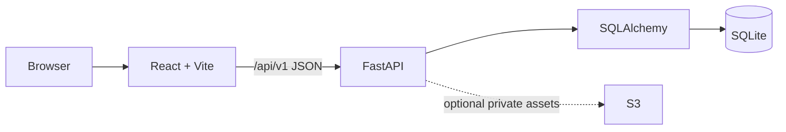

# ProjectSpace

**A student project showcase and peer-feedback platform built with React, FastAPI, and SQLAlchemy.**

ProjectSpace helps students publish work, discover projects across 20 engineering domains, save ideas, follow domains, exchange feedback, and learn from an active gallery. The preserved catalog contains **320 projects**, with real repository links where available.

> Cloud status: the application is fully verified for local demonstration. AWS deployment is deliberately unprovisioned under the strict ₹0 policy; no AWS resource or public deployment URL is claimed.

## Highlights

- Search, sort, and domain discovery across all 320 projects.
- Separate **AI & Machine Learning** and **Data Science & Analytics** domains.
- Project detail views, repository links, comments, voting, saved projects, and recommendations.
- Account registration, login/logout, PBKDF2 password hashing, signed sessions, CSRF checks, and server-side ownership enforcement.
- Author profiles, project publishing/editing/deletion, persistent category following, and local description suggestions.
- Swagger/OpenAPI documentation, health checks, Docker configuration, optional private S3 asset integration, and AWS infrastructure templates.

## Supported domains

AI & Machine Learning · Data Science & Analytics · Cybersecurity · Cloud Computing · Web Development & Full Stack · Mobile App Development · DevOps & Automation · Computer Vision · Internet of Things · Blockchain & Web3 · AR/VR & Game Development · HealthTech · FinTech · EdTech · Robotics & Embedded Systems · Natural Language Processing · Networking & Distributed Systems · UI/UX & Product Design · Open Source & Developer Utilities · Sustainability & Social Impact.

## Stack

| Layer | Technology |
|---|---|
| Frontend | React, Vite, CSS, Lucide icons |
| API | FastAPI, Pydantic, Uvicorn, OpenAPI |
| Data | SQLAlchemy and SQLite; PostgreSQL-ready configuration |
| Security | PBKDF2 hashing, signed HttpOnly sessions, CSRF, validation, owner checks |
| Quality | Pytest, Locust, async benchmark, health endpoint |
| Cloud readiness | Docker, Compose, S3 integration, ECR/ECS/RDS/S3/CloudFront templates |

## Architecture



The demonstrated configuration is React + FastAPI + the preserved local SQLite database. See [ARCHITECTURE.md](ARCHITECTURE.md) and [DEPLOYMENT_GUIDE.md](DEPLOYMENT_GUIDE.md) for the cloud-ready design and zero-cost constraints.

## Run on Windows

Requirements: Python 3.11+ (tested with Python 3.13), Node.js 20+, npm.

Install dependencies once:

```powershell
pip install -r backend/requirements.txt
cd frontend
npm install
cd ..
```

Start the API in one PowerShell window:

```powershell
.\scripts\start-backend.ps1
```

Start the frontend in a second window:

```powershell
.\scripts\start-frontend.ps1
```

Open:

- Application: http://127.0.0.1:5173
- API documentation: http://127.0.0.1:8000/docs
- Health check: http://127.0.0.1:8000/health

The startup script explicitly selects the preserved root `showcase.db`, rather than the older backend-local sample database.

## API overview

| Area | Examples |
|---|---|
| Projects | `GET/POST /api/v1/projects`, `GET/PUT/DELETE /api/v1/projects/{id}` |
| Engagement | votes, comments, bookmarks, category preferences, recommendations |
| Accounts | register, login, logout, current profile, profile update |
| Operations | `/health`, `/docs`, `/redoc` |

Open `/docs` for the live generated contract and request schemas.

## Data and security

The primary local database is preserved and checkpointed before implementation. Record-level verification confirms 320 projects, 120 users, 110 comments, 374 votes, 20 categories, and no missing project IDs, user IDs, or GitHub links.

Credentials are never stored in frontend code. Optional S3 support stays disabled until `S3_BUCKET_NAME` is configured. Cloud credentials belong only in local credential profiles or managed secret stores, never in Git.

## Testing results

| Check | Result |
|---|---|
| Backend/API/migration suite | 30 passed |
| Frontend production build | Passed |
| Isolated async benchmark | 10, 25, 50 users; 100% successful requests |
| Isolated Locust stages | 10, 25, 50 users; 0 reported failures |

Full measured results are in [TEST_RESULTS.md](TEST_RESULTS.md). Load tests use a disposable database copy, not the preserved catalog.

## Cloud and cost policy

The repository includes deployment-ready Docker and AWS templates for academic architecture evidence. They are **not deployed** because ECS, ALB, RDS, and related services have recurring-cost risk. Amplify/S3 eligibility, account credits, and overage exposure must be verified before any AWS resource can be created. See [docs/zero-cost-cloud-plan.md](docs/zero-cost-cloud-plan.md).

## Project structure

```text
backend/        FastAPI application, models, API tests, seed tools
frontend/       React/Vite interface
infra/aws/      CloudFormation reference templates
loadtests/      Locust and async benchmark tools
scripts/        Windows startup scripts
docs/           Architecture, deployment, cloud and testing documentation
submission/     Presentation-document index
```

## Academic evidence

- [Web application 50-mark matrix](WEB_50_MARKS.md)
- [Cloud computing 50-mark matrix](CLOUD_50_MARKS.md)
- [Presentation guide](PRESENTATION_GUIDE.md)
- [Demonstration script](DEMO_SCRIPT.md)
- [Screenshot checklist](SCREENSHOT_CHECKLIST.md)

## Limitations and future work

The local SQLite configuration is ideal for the academic demo but is not a multi-instance production database. A future approved deployment would use a verified data migration, private object storage, managed secrets, and an account-approved hosting plan. No such deployment is claimed here.


