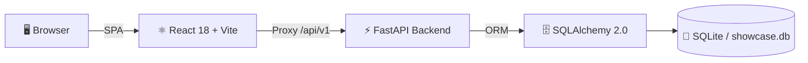

<div align="center">

# ✦ ProjectSpace

**A curated student project showcase and peer-feedback platform.**

Discover innovations, review code, exchange technical feedback, and explore capstone projects across 20 engineering domains.

<br/>

[](https://react.dev)
[](https://vitejs.dev)
[](https://fastapi.tiangolo.com)
[](https://python.org)
[](https://sqlite.org)
[](backend/tests)

</div>

---

### 🖥️ Interface Preview

```text
┌──────────────────────────────────────────────────────────────────────────┐
│ 🚀 ProjectSpace               🔍 Search 320 projects...        [Sign In] │
├──────────────────────────────────────────────────────────────────────────┤
│ 🏷️ [All] [AI & ML] [Data Science] [Cybersecurity] [Cloud] [Web Dev] ...  │
├──────────────────────────────────────────────────────────────────────────┤
│ ┌─────────────────────────────┐    ┌─────────────────────────────┐       │
│ │ 🤖 Vision AI Pipeline       │    │ 🛡️ Sentinel Packet Guard    │       │
│ │ Computer Vision • ▲ 42      │    │ Cybersecurity • ▲ 38        │       │
│ │ Real-time edge detection    │    │ Zero-trust network monitor  │       │
│ │ [GitHub ↗]  [Details]       │    │ [GitHub ↗]  [Details]       │       │
│ └─────────────────────────────┘    └─────────────────────────────┘       │
└──────────────────────────────────────────────────────────────────────────┘
```

---

### 📊 Platform Metrics

| Curated Projects | Active Authors | Peer Votes | Feedback Reviews | Engineering Tracks |
| :---: | :---: | :---: | :---: | :---: |
| **320** | **120** | **374** | **110** | **20** |

---

### 🏗️ Architecture



---

### ⚡ Quickstart

#### 1. Install Dependencies

```bash
pip install -r backend/requirements.txt
npm --prefix frontend install
```

#### 2. Start Backend API
```powershell
# Windows
cd backend
$env:DATABASE_URL = "sqlite:///../showcase.db"
python -m uvicorn app.main:app --host 127.0.0.1 --port 8000 --reload
```
```bash
# macOS / Linux
cd backend
export DATABASE_URL="sqlite:///../showcase.db"
python -m uvicorn app.main:app --host 127.0.0.1 --port 8000 --reload
```

#### 3. Start Frontend Client
```bash
cd frontend
npm run dev -- --host 127.0.0.1 --port 5173
```

#### 🌐 Services

* **Application:** `http://localhost:5173`
* **Swagger API Docs:** `http://localhost:8000/docs`
* **Health Check:** `http://localhost:8000/health`

---

### 🏷️ 20 Engineering Tracks

| Track 1 – 5 | Track 6 – 10 | Track 11 – 15 | Track 16 – 20 |
|---|---|---|---|
| 🤖 AI & Machine Learning | 📱 Mobile App Development | 🥽 AR/VR & Game Dev | 💬 Natural Language Processing |
| 📊 Data Science & Analytics | ⚙️ DevOps & Automation | 🏥 HealthTech | 🌐 Networking & Systems |
| 🛡️ Cybersecurity | 👁️ Computer Vision | 💳 FinTech | 🎨 UI/UX & Product Design |
| ☁️ Cloud Computing | 📡 Internet of Things | 📚 EdTech | 🛠️ Developer Utilities |
| 💻 Web & Full Stack Dev | ⛓️ Blockchain & Web3 | 🦾 Robotics & Embedded | 🌱 Sustainability & Impact |

---

### 🛡️ Security & Core Features

* **Authentication:** Passwords hashed with PBKDF2-SHA256 (310,000 rounds + random salt).
* **Sessions:** Signed HttpOnly cookie tokens with session version invalidation.
* **Integrity:** Double-submit CSRF tokens on all state-changing endpoints.
* **Authorization:** Server-side author verification for editing and deleting projects.
* **Engagement:** Upvoting/downvoting with duplicate prevention, comments, and bookmarks.
* **Testing:** 30 automated API tests, isolated load tests, and production build verification.

---

### 📁 Repository Structure

```text
Student-Project-Showcase-and-Gallery/
├── backend/          # FastAPI application, models, routers, and test suite
├── frontend/         # React 18 single-page application and styles
├── docs/             # Technical architecture and deployment documentation
├── infra/            # Reference CloudFormation and IAM policy templates
├── loadtests/        # Locust and async benchmarking tools
├── docker-compose.yml# Container orchestration configuration
├── showcase.db       # Preserved 320-project catalog database
├── .gitignore        # Git exclusion rules
└── README.md         # Project documentation
```

---

<div align="center">
  <sub>Built with React, FastAPI & SQLAlchemy • 2026</sub>
</div>
