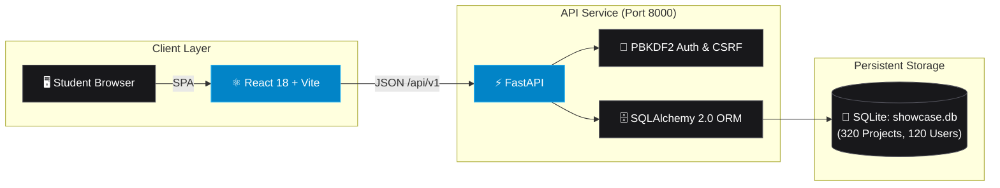

<div align="center">

# 🚀 ProjectSpace
### Student Project Showcase & Peer-Feedback Platform

A full-stack web platform for engineering students to discover 320+ capstone projects across 20 technical domains, exchange constructive peer feedback, and showcase technical work.

<br/>

[](https://react.dev)
[](https://vitejs.dev)
[](https://fastapi.tiangolo.com)
[](https://python.org)
[](https://sqlite.org)
[](backend/tests)

<br/>

`🟢 System: Verified & Operational` &nbsp;•&nbsp; `📦 Catalog: 320 Real Projects` &nbsp;•&nbsp; `🛡️ Policy: Strict ₹0 Cloud`

</div>

---

### 🖥️ Application Interface

```text
┌─── ProjectSpace Browser ────────────────────────────────────────────────────────┐
│  ● ● ●  http://localhost:5173                                  🔍 Search 320+   │
├─────────────────────────────────────────────────────────────────────────────────┤
│                                                                                 │
│   🏷️  [All]  [AI & ML]  [Data Science]  [Cybersecurity]  [Cloud]  [Web Dev]     │
│                                                                                 │
│   ┌───────────────────────────────┐     ┌───────────────────────────────┐       │
│   │ 🤖 Vision AI Pipeline         │     │ 🛡️ Sentinel Packet Guard      │       │
│   │ Track: Computer Vision        │     │ Track: Cybersecurity          │       │
│   │ ▲ 42 Upvotes • 12 Comments    │     │ ▲ 38 Upvotes • 9 Comments     │       │
│   │ [View Source ↗] [Details Modal│     │ [View Source ↗] [Details Modal│       │
│   └───────────────────────────────┘     └───────────────────────────────┘       │
│                                                                                 │
└─────────────────────────────────────────────────────────────────────────────────┘
```

---

### 📊 Platform Highlights

| 📦 Preserved Projects | 👥 Student Authors | 👍 Peer Votes | 💬 Review Comments | 🏷️ Technical Domains |
| :---: | :---: | :---: | :---: | :---: |
| **320** | **120** | **374** | **110** | **20** |

---

### 🏗️ Visual Architecture



---

### ⚡ Quickstart

<details open>
<summary><b>▶️ Click to view Launch Instructions</b></summary>
<br/>

#### 1. Setup Dependencies
```bash
pip install -r backend/requirements.txt
npm --prefix frontend install
```

#### 2. Start FastAPI Backend (Port 8000)
```powershell
# Windows
cd backend
$env:DATABASE_URL = "sqlite:///../showcase.db"
python -m uvicorn app.main:app --host 127.0.0.1 --port 8000 --reload
```
```bash
# macOS / Linux
cd backend
export DATABASE_URL="sqlite:///../showcase.db"
python -m uvicorn app.main:app --host 127.0.0.1 --port 8000 --reload
```

#### 3. Start React Frontend (Port 5173)
```bash
cd frontend
npm run dev -- --host 127.0.0.1 --port 5173
```

#### 🌐 Active Service Endpoints
* **Web UI:** `http://localhost:5173`
* **Swagger API Docs:** `http://localhost:8000/docs`
* **Health Endpoint:** `http://localhost:8000/health`

</details>

---

### 🏷️ 20 Engineering Tracks

<details>
<summary><b>📂 Click to view all 20 Supported Domains</b></summary>
<br/>

| Track 1 – 5 | Track 6 – 10 | Track 11 – 15 | Track 16 – 20 |
|---|---|---|---|
| 🤖 AI & Machine Learning | 📱 Mobile App Development | 🥽 AR/VR & Game Dev | 💬 Natural Language Processing |
| 📊 Data Science & Analytics | ⚙️ DevOps & Automation | 🏥 HealthTech | 🌐 Networking & Systems |
| 🛡️ Cybersecurity | 👁️ Computer Vision | 💳 FinTech | 🎨 UI/UX & Product Design |
| ☁️ Cloud Computing | 📡 Internet of Things | 📚 EdTech | 🛠️ Developer Utilities |
| 💻 Web & Full Stack Dev | ⛓️ Blockchain & Web3 | 🦾 Robotics & Embedded | 🌱 Sustainability & Impact |

</details>

---

### 🛡️ Security & Reliability

* 🔑 **Cryptographic Passwords:** PBKDF2-SHA256 with 310,000 rounds and unique salt.
* 🍪 **Signed HttpOnly Cookies:** Session tokens protected against XSS and tampering.
* 🛡️ **Double-Submit CSRF:** Protection across all state-mutating requests.
* 👤 **Ownership Enforcement:** Server-side author validation for project edit and delete actions.
* ☁️ **Honest ₹0 Cloud Strategy:** Local zero-cost demonstration; AWS architectures (IAM, ECS, RDS, S3) prepared as IaC templates without unapproved cloud billing.

---

### 📁 Clean Repository Structure

```text
Student-Project-Showcase-and-Gallery/
├── backend/          # FastAPI application, SQLAlchemy models, Pydantic schemas, 30 tests
├── frontend/         # React 18 single-page application and responsive UI styles
├── docs/             # Technical architecture, deployment specs, and ₹0 plan
├── infra/            # Reference AWS CloudFormation and least-privilege IAM policies
├── loadtests/        # Locust and async load benchmarking tools
├── docker-compose.yml# Container orchestration configuration
├── showcase.db       # Preserved 320-project catalog database
├── .gitignore        # Git exclusion rules
└── README.md         # Visual interactive documentation
```

---

<div align="center">
  <sub>Built with React, FastAPI & SQLAlchemy • Student Project Showcase Platform</sub>
</div>
