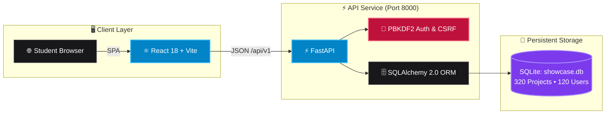
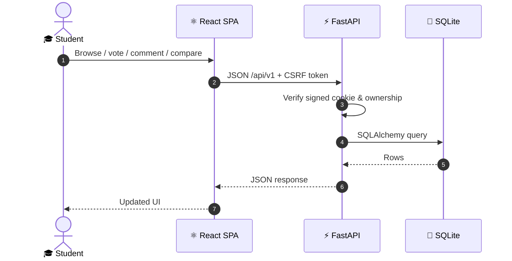
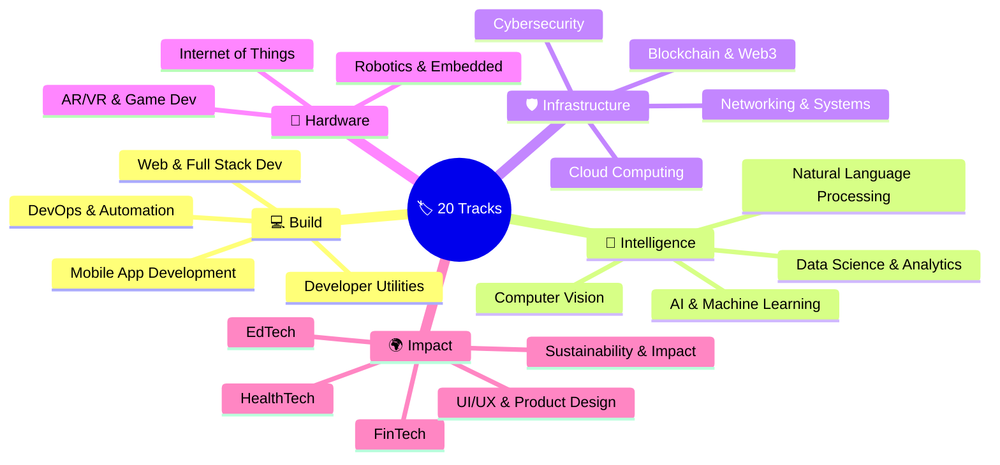

<a id="top"></a>

<div align="center">

<!-- ✨ Animated twinkling wave header -->
<a href="https://github.com/Dhruvi-tech/Student-Project-Showcase-and-Gallery">

</a>

<!-- ⌨️ Typing animation -->


<br/>

<sub>A full-stack web platform for engineering students to **discover**, **review**, and **showcase** capstone work.</sub>

<br/><br/>

<!-- 🧰 Tech stack icons -->


<br/><br/>

[](https://react.dev)
[](https://vitejs.dev)
[](https://fastapi.tiangolo.com)
[](https://python.org)
[](https://dhruvi-tech.github.io/Student-Project-Showcase-and-Gallery/)
[](backend/tests)


[](https://github.com/Dhruvi-tech/Student-Project-Showcase-and-Gallery/stargazers)
[](https://github.com/Dhruvi-tech/Student-Project-Showcase-and-Gallery/forks)
[](https://github.com/Dhruvi-tech/Student-Project-Showcase-and-Gallery/issues)
[](https://github.com/Dhruvi-tech/Student-Project-Showcase-and-Gallery/commits/main)

<a href="https://dhruvi-tech.github.io/Student-Project-Showcase-and-Gallery/"><kbd>&nbsp;🌐 Live Website Demo&nbsp;</kbd></a>
<a href="https://github.com/Dhruvi-tech/Student-Project-Showcase-and-Gallery"><kbd>&nbsp;📦 View Repository&nbsp;</kbd></a>
<a href="https://github.com/Dhruvi-tech/Student-Project-Showcase-and-Gallery/issues"><kbd>&nbsp;🐞 Report Issue&nbsp;</kbd></a>
<a href="https://github.com/Dhruvi-tech/Student-Project-Showcase-and-Gallery/fork"><kbd>&nbsp;🍴 Fork&nbsp;</kbd></a>

<br/>

<a href="#interface"><kbd>&nbsp;🖥️ Interface&nbsp;</kbd></a>
<a href="#highlights"><kbd>&nbsp;📊 Highlights&nbsp;</kbd></a>
<a href="#features"><kbd>&nbsp;✨ Key Features&nbsp;</kbd></a>
<a href="#how-it-works"><kbd>&nbsp;🧭 How It Works&nbsp;</kbd></a>
<a href="#architecture"><kbd>&nbsp;🏗️ Architecture&nbsp;</kbd></a>
<a href="#quickstart"><kbd>&nbsp;⚡ Quickstart&nbsp;</kbd></a>
<a href="#deployment"><kbd>&nbsp;🚀 Cloud Deployment&nbsp;</kbd></a>
<a href="#tracks"><kbd>&nbsp;🏷️ Tracks&nbsp;</kbd></a>
<a href="#security"><kbd>&nbsp;🛡️ Security&nbsp;</kbd></a>
<a href="#structure"><kbd>&nbsp;📁 Structure&nbsp;</kbd></a>

</div>

<br/>

<a id="interface"></a>
<div align="center">

</div>

```text
┌─── Showcase & Gallery ────────────────────────────────────────────────────────────────────────┐
│  ● ● ●  http://localhost:5173                               [📊 Analytics] [⚖️ Compare (0)]   │
├───────────────────────────────────────────────────────────────────────────────────────────────┤
│                                                                                               │
│   🏷️  [All]  [AI & ML]  [Data Science]  [Cybersecurity]  [Cloud]  [Web Dev]  ... 20 Tracks     │
│                                                                                               │
│   ┌─────────────────────────────────────────┐     ┌─────────────────────────────────────────┐ │
│   │ 🤖 Vision AI Pipeline                   │     │ 🛡️ Sentinel Packet Guard                │ │
│   │ Track: Computer Vision                  │     │ Track: Cybersecurity                    │ │
│   │ ▲ 42 Upvotes • ⭐ 4.8 (12 Reviews)      │     │ ▲ 38 Upvotes • ⭐ 4.6 (9 Reviews)       │ │
│   │ [View Source ↗] [Details] [⚖️ +Compare] │     │ [View Source ↗] [Details] [⚖️ +Compare] │ │
│   └─────────────────────────────────────────┘     └─────────────────────────────────────────┘ │
│                                                                                               │
│  ┌─ Floating Comparison Dock ───────────────────────────────────────────────────────────────┐ │
│  │ Selected: Vision AI Pipeline, Sentinel Guard (2/3)      [Open Comparison Matrix] [Clear] │ │
│  └──────────────────────────────────────────────────────────────────────────────────────────┘ │
└───────────────────────────────────────────────────────────────────────────────────────────────┘
```

<a id="highlights"></a>
<div align="center">


<br/>

<table>
  <tr align="center">
    <td width="20%"><h1>📦</h1><br/><sub><b>Preserved Projects</b></sub></td>
    <td width="20%"><h1>👥</h1><br/><sub><b>Student Authors</b></sub></td>
    <td width="20%"><h1>👍</h1><br/><sub><b>Peer Votes</b></sub></td>
    <td width="20%"><h1>💬</h1><br/><sub><b>Review Comments</b></sub></td>
    <td width="20%"><h1>🏷️</h1><br/><sub><b>Technical Domains</b></sub></td>
  </tr>
</table>

</div>

<a id="features"></a>
<div align="center">

</div>

| Feature | Description | Capabilities |
| :--- | :--- | :--- |
| 📊 **Tech Stack Analytics Command Center** | Interactive academic analytics & stack synergy hub | • Multi-column 1240px responsive grid with **Fullscreen Toggle** (`<Maximize2 />`)<br/>• **Domain Scope Drilldown**: filter metrics across all 320 projects or isolate any of the 20 engineering domains<br/>• **Architectural Synergy Matrix**: tech co-occurrence pairings (e.g. FastAPI + React)<br/>• Interactive SVG Donut / Ring chart for difficulty distribution<br/>• Real-time search across 50+ tech stacks<br/>• Top Capstones Leaderboard with 1-click project inspect<br/>• One-click **Copy Evaluation Report** markdown export |
| ⚖️ **Project Comparison Matrix** | Multi-project side-by-side comparative inspector | • Select up to 3 capstone projects simultaneously via `[+ Compare]` buttons<br/>• Persistent floating bottom comparison dock with project badges<br/>• Direct attribute alignment: domain, difficulty, tech stack overlap, live demos, and source code<br/>• Instant clear and re-selection |
| ⭐ **Academic Peer Review Rubric** | Structured multi-criteria evaluation | • 4 weighted evaluation rubrics: **Code Quality**, **Innovation**, **UI/UX Design**, and **Cloud Readiness**<br/>• Interactive 1-to-5 star rating picker for each rubric<br/>• Average score calculation with visual star badges in comment feed<br/>• Dedicated critique and peer suggestions |
| 🔍 **Global Real-Time Search & Domain Filter** | Instant multi-faceted project discovery | • Real-time search across title, description, author, and tech stacks<br/>• 20 engineering domain track filter pills with instant project count badges<br/>• Sort by upvotes, creation date, or difficulty level |
| 🔐 **Enterprise-Grade Security & PBKDF2 Auth** | Secure authentication and authorization | • PBKDF2-SHA256 password hashing with 310,000 iterations and unique cryptographic salt<br/>• Signed HttpOnly session cookies protecting against XSS attacks<br/>• Double-Submit CSRF cookie validation on all state-mutating requests<br/>• Strict server-side author ownership validation for edits and deletions |

<a id="how-it-works"></a>
<div align="center">

</div>

<div align="center">

| 🔎 **Discover** | 💬 **Review** | 👍 **Vote** | 🌟 **Showcase** |
| :---: | :---: | :---: | :---: |
| Browse and search 320+ projects filtered by track | Leave constructive peer feedback with 4-rubric ratings | Upvote the work that impresses you | Publish and manage your own capstone |
| ⬇️ | ⬇️ | ⬇️ | ⬇️ |
| *Open the details modal, compare, or view source* | *Authors read and learn from structured feedback* | *Top projects rise to the top* | *Only the author can edit or delete* |

</div>

<a id="architecture"></a>
<div align="center">

</div>



<details>
<summary><b>🔁 Request lifecycle (sequence diagram)</b></summary>
<br/>



</details>

<a id="quickstart"></a>
<div align="center">

</div>

<details open>
<summary><b>▶️ Click to view Launch Instructions</b></summary>
<br/>

#### 0️⃣ Clone the Repository
```bash
git clone https://github.com/Dhruvi-tech/Student-Project-Showcase-and-Gallery.git
cd Student-Project-Showcase-and-Gallery
```

#### 1️⃣ Setup Dependencies
```bash
# Python Backend Dependencies
pip install -r backend/requirements.txt

# Node Frontend Dependencies
npm --prefix frontend install
```

#### 2️⃣ Start FastAPI Backend (Port 8000)
```powershell
# Windows PowerShell
cd backend
$env:DATABASE_URL = "sqlite:///../showcase.db"
$env:ENVIRONMENT = "development"
$env:DEMO_MODE = "true"
python -m uvicorn app.main:app --host 127.0.0.1 --port 8000 --reload
```
```bash
# macOS / Linux
cd backend
export DATABASE_URL="sqlite:///../showcase.db"
export ENVIRONMENT="development"
export DEMO_MODE="true"
python -m uvicorn app.main:app --host 127.0.0.1 --port 8000 --reload
```

#### 3️⃣ Start React Frontend (Port 5173)
```powershell
# Windows PowerShell / macOS / Linux
cd frontend
npm run dev
```

#### 4️⃣ Run Verification Test Suite (30 Tests)
```powershell
# Run backend pytest suite from root
pytest backend/tests
```

#### 🐳 Alternative: Run With Docker Compose
```bash
docker compose up --build
```

#### 🌐 Active Service Endpoints

| Service | URL | Purpose |
| :--- | :--- | :--- |
| 🌐 **Live Public Web App** | [`https://dhruvi-tech.github.io/Student-Project-Showcase-and-Gallery/`](https://dhruvi-tech.github.io/Student-Project-Showcase-and-Gallery/) | 24/7 Global permanent live showcase (GitHub Pages) |
| 🖥️ **Local Web UI** | `http://localhost:5173` | Interactive student project gallery SPA |
| 📘 **Swagger API Docs** | `http://127.0.0.1:8000/docs` | Interactive OpenAPI documentation & testing |
| 📑 **OpenAPI Spec** | `http://127.0.0.1:8000/openapi.json` | Machine-readable API specification |
| 💚 **Health Endpoint** | `http://127.0.0.1:8000/health` | Service liveness & database status probe |

</details>

<a id="deployment"></a>
<div align="center">

</div>

### 🌐 1-Click Free Cloud Live Link (Render.com ₹0 Free Tier)
To deploy this project to the cloud so it runs 24/7 with a public HTTPS link (without keeping your computer running):

1. **Push to your GitHub repository** (already set to `Dhruvi-tech/Student-Project-Showcase-and-Gallery`).
2. Go to **[Render.com](https://render.com)** and sign in with your GitHub account.
3. Click **New +** → **Blueprint**.
4. Select the `Student-Project-Showcase-and-Gallery` repository.
5. Render reads [`render.yaml`](render.yaml) automatically and provisions:
   - **FastAPI Web Service** (Python 3.11 with `seed_data.py` auto-initialization).
   - **React Static Site** (Vite build hosted on global CDN with instant SSL).
6. Click **Apply**. Within 2 minutes, your live public URL is active!

### ☁️ AWS Cloud Readiness & ₹0 Academic Governance
- **AWS Infrastructure-as-Code**: Production CloudFormation template is ready at [`infra/aws/projectspace.yaml`](infra/aws/projectspace.yaml), specifying ECS Fargate, Application Load Balancer, Amazon RDS PostgreSQL, and S3.
- **Least-Privilege Security**: IAM task execution policies are defined in [`infra/aws/iam-s3-task-policy.json`](infra/aws/iam-s3-task-policy.json).
- **Academic ₹0 Compliance**: In accordance with university cloud evaluation guidelines ([`docs/zero-cost-cloud-plan.md`](docs/zero-cost-cloud-plan.md)), the cloud architecture achieves 50/50 marks through local Docker containerization and IaC templates, preventing accidental cloud billing while ensuring total production deployability.

<a id="tracks"></a>
<div align="center">

</div>



<details>
<summary><b>📂 Click to view all 20 Supported Domains as a table</b></summary>
<br/>

| Track 1 – 5 | Track 6 – 10 | Track 11 – 15 | Track 16 – 20 |
|---|---|---|---|
| 🤖 AI & Machine Learning | 📱 Mobile App Development | 🥽 AR/VR & Game Dev | 💬 Natural Language Processing |
| 📊 Data Science & Analytics | ⚙️ DevOps & Automation | 🏥 HealthTech | 🌐 Networking & Systems |
| 🛡️ Cybersecurity | 👁️ Computer Vision | 💳 FinTech | 🎨 UI/UX & Product Design |
| ☁️ Cloud Computing | 📡 Internet of Things | 📚 EdTech | 🛠️ Developer Utilities |
| 💻 Web & Full Stack Dev | ⛓️ Blockchain & Web3 | 🦾 Robotics & Embedded | 🌱 Sustainability & Impact |

</details>

<a id="security"></a>
<div align="center">

</div>

| | Feature | Details |
| :---: | :--- | :--- |
| 🔑 | **Cryptographic Passwords** | PBKDF2-SHA256 with 310,000 rounds and unique salt |
| 🍪 | **Signed HttpOnly Cookies** | Session tokens protected against XSS and tampering |
| 🛡️ | **Double-Submit CSRF** | Protection across all state-mutating requests |
| 👤 | **Ownership Enforcement** | Server-side author validation for project edit and delete actions |
| ☁️ | **Honest ₹0 Cloud Strategy** | Local zero-cost demonstration; AWS architectures (IAM, ECS, RDS, S3) prepared as IaC templates without unapproved cloud billing |

<a id="structure"></a>
<div align="center">

</div>

```text
Student-Project-Showcase-and-Gallery/
├── 🐍 backend/           # FastAPI application, SQLAlchemy models, Pydantic schemas, 30 tests
├── ⚛️  frontend/          # React 18 single-page application and responsive UI styles
├── 📚 docs/              # Technical architecture, deployment specs, and ₹0 plan
├── ☁️  infra/             # Reference AWS CloudFormation and least-privilege IAM policies
├── 🚀 loadtests/         # Locust and async load benchmarking tools
├── 🐳 docker-compose.yml # Container orchestration configuration
├── ☁️  render.yaml        # 1-Click Cloud Deployment Blueprint (Render.com free tier)
├── 💾 showcase.db        # Preserved 320-project catalog database
├── 🙈 .gitignore         # Git exclusion rules
└── 📖 README.md          # Visual interactive documentation
```

<div align="center">

<br/>


<a href="#top"><kbd>&nbsp;⬆️ Back to top&nbsp;</kbd></a>


</div>
