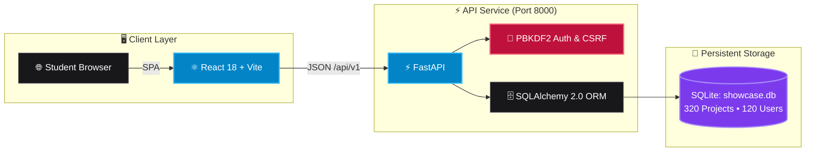
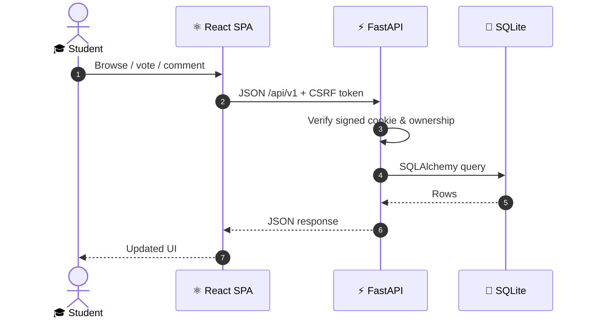
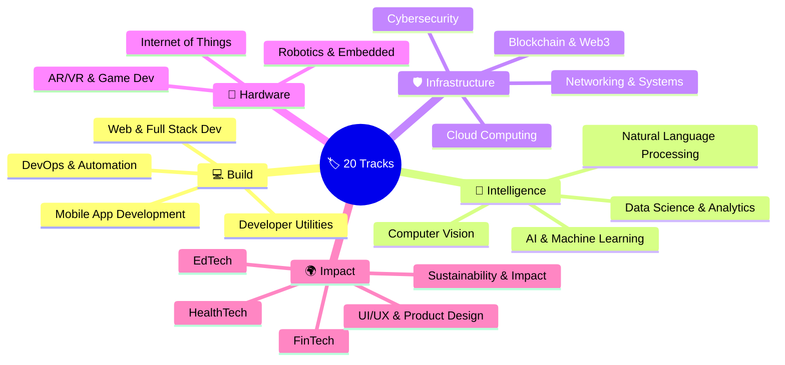

<a id="top"></a>

<div align="center">

<!-- ✨ Animated twinkling wave header -->
<a href="https://github.com/Dhruvi-tech/Student-Project-Showcase-and-Gallery">

</a>

<!-- ⌨️ Typing animation -->


<br/>

<sub>A full-stack web platform for engineering students to **discover**, **review**, and **showcase** capstone work.</sub>

<br/><br/>

<!-- 🧰 Tech stack icons -->


<br/><br/>

[](https://react.dev)
[](https://vitejs.dev)
[](https://fastapi.tiangolo.com)
[](https://python.org)
[](https://sqlite.org)
[](backend/tests)


[](https://github.com/Dhruvi-tech/Student-Project-Showcase-and-Gallery/stargazers)
[](https://github.com/Dhruvi-tech/Student-Project-Showcase-and-Gallery/forks)
[](https://github.com/Dhruvi-tech/Student-Project-Showcase-and-Gallery/issues)
[](https://github.com/Dhruvi-tech/Student-Project-Showcase-and-Gallery/commits/main)

<a href="https://github.com/Dhruvi-tech/Student-Project-Showcase-and-Gallery"><kbd>&nbsp;📦 View Repository&nbsp;</kbd></a>
<a href="https://github.com/Dhruvi-tech/Student-Project-Showcase-and-Gallery/issues"><kbd>&nbsp;🐞 Report Issue&nbsp;</kbd></a>
<a href="https://github.com/Dhruvi-tech/Student-Project-Showcase-and-Gallery/fork"><kbd>&nbsp;🍴 Fork&nbsp;</kbd></a>

<br/>

<a href="#interface"><kbd>&nbsp;🖥️ Interface&nbsp;</kbd></a>
<a href="#highlights"><kbd>&nbsp;📊 Highlights&nbsp;</kbd></a>
<a href="#how-it-works"><kbd>&nbsp;🧭 How It Works&nbsp;</kbd></a>
<a href="#architecture"><kbd>&nbsp;🏗️ Architecture&nbsp;</kbd></a>
<a href="#quickstart"><kbd>&nbsp;⚡ Quickstart&nbsp;</kbd></a>
<a href="#tracks"><kbd>&nbsp;🏷️ Tracks&nbsp;</kbd></a>
<a href="#security"><kbd>&nbsp;🛡️ Security&nbsp;</kbd></a>
<a href="#structure"><kbd>&nbsp;📁 Structure&nbsp;</kbd></a>

</div>

<br/>

<a id="interface"></a>
<div align="center">

</div>

```text
┌─── Showcase & Gallery ─────────────────────────────────────────────────────────┐
│  ● ● ●  http://localhost:5173                                  🔍 Search 320+   │
├─────────────────────────────────────────────────────────────────────────────────┤
│                                                                                 │
│   🏷️  [All]  [AI & ML]  [Data Science]  [Cybersecurity]  [Cloud]  [Web Dev]     │
│                                                                                 │
│   ┌───────────────────────────────┐     ┌───────────────────────────────┐       │
│   │ 🤖 Vision AI Pipeline         │     │ 🛡️ Sentinel Packet Guard      │       │
│   │ Track: Computer Vision        │     │ Track: Cybersecurity          │       │
│   │ ▲ 42 Upvotes • 12 Comments    │     │ ▲ 38 Upvotes • 9 Comments     │       │
│   │ [View Source ↗] [Details Modal│     │ [View Source ↗] [Details Modal│       │
│   └───────────────────────────────┘     └───────────────────────────────┘       │
│                                                                                 │
└─────────────────────────────────────────────────────────────────────────────────┘
```

<a id="highlights"></a>
<div align="center">


<br/>

<table>
  <tr align="center">
    <td width="20%"><h1>📦</h1><br/><sub><b>Preserved Projects</b></sub></td>
    <td width="20%"><h1>👥</h1><br/><sub><b>Student Authors</b></sub></td>
    <td width="20%"><h1>👍</h1><br/><sub><b>Peer Votes</b></sub></td>
    <td width="20%"><h1>💬</h1><br/><sub><b>Review Comments</b></sub></td>
    <td width="20%"><h1>🏷️</h1><br/><sub><b>Technical Domains</b></sub></td>
  </tr>
</table>

</div>

<a id="how-it-works"></a>
<div align="center">

</div>

<div align="center">

| 🔎 **Discover** | 💬 **Review** | 👍 **Vote** | 🌟 **Showcase** |
| :---: | :---: | :---: | :---: |
| Browse and search 320+ projects filtered by track | Leave constructive peer feedback in comments | Upvote the work that impresses you | Publish and manage your own capstone |
| ⬇️ | ⬇️ | ⬇️ | ⬇️ |
| *Open the details modal or view the source* | *Authors read and learn from feedback* | *Top projects rise to the top* | *Only the author can edit or delete* |

</div>

<a id="architecture"></a>
<div align="center">

</div>



<details>
<summary><b>🔁 Request lifecycle (sequence diagram)</b></summary>
<br/>



</details>

<a id="quickstart"></a>
<div align="center">

</div>

<details open>
<summary><b>▶️ Click to view Launch Instructions</b></summary>
<br/>

#### 0️⃣ Clone the Repository
```bash
git clone https://github.com/Dhruvi-tech/Student-Project-Showcase-and-Gallery.git
cd Student-Project-Showcase-and-Gallery
```

#### 1️⃣ Setup Dependencies
```bash
pip install -r backend/requirements.txt
npm --prefix frontend install
```

#### 2️⃣ Start FastAPI Backend (Port 8000)
```powershell
# Windows
cd backend
$env:DATABASE_URL = "sqlite:///../showcase.db"
python -m uvicorn app.main:app --host 127.0.0.1 --port 8000 --reload
```
```bash
# macOS / Linux
cd backend
export DATABASE_URL="sqlite:///../showcase.db"
python -m uvicorn app.main:app --host 127.0.0.1 --port 8000 --reload
```

#### 3️⃣ Start React Frontend (Port 5173)
```bash
cd frontend
npm run dev -- --host 127.0.0.1 --port 5173
```

#### 🌐 Active Service Endpoints

| Service | URL |
| :--- | :--- |
| 🖥️ **Web UI** | `http://localhost:5173` |
| 📘 **Swagger API Docs** | `http://localhost:8000/docs` |
| 💚 **Health Endpoint** | `http://localhost:8000/health` |

</details>

<a id="tracks"></a>
<div align="center">

</div>



<details>
<summary><b>📂 Click to view all 20 Supported Domains as a table</b></summary>
<br/>

| Track 1 – 5 | Track 6 – 10 | Track 11 – 15 | Track 16 – 20 |
|---|---|---|---|
| 🤖 AI & Machine Learning | 📱 Mobile App Development | 🥽 AR/VR & Game Dev | 💬 Natural Language Processing |
| 📊 Data Science & Analytics | ⚙️ DevOps & Automation | 🏥 HealthTech | 🌐 Networking & Systems |
| 🛡️ Cybersecurity | 👁️ Computer Vision | 💳 FinTech | 🎨 UI/UX & Product Design |
| ☁️ Cloud Computing | 📡 Internet of Things | 📚 EdTech | 🛠️ Developer Utilities |
| 💻 Web & Full Stack Dev | ⛓️ Blockchain & Web3 | 🦾 Robotics & Embedded | 🌱 Sustainability & Impact |

</details>

<a id="security"></a>
<div align="center">

</div>

| | Feature | Details |
| :---: | :--- | :--- |
| 🔑 | **Cryptographic Passwords** | PBKDF2-SHA256 with 310,000 rounds and unique salt |
| 🍪 | **Signed HttpOnly Cookies** | Session tokens protected against XSS and tampering |
| 🛡️ | **Double-Submit CSRF** | Protection across all state-mutating requests |
| 👤 | **Ownership Enforcement** | Server-side author validation for project edit and delete actions |
| ☁️ | **Honest ₹0 Cloud Strategy** | Local zero-cost demonstration; AWS architectures (IAM, ECS, RDS, S3) prepared as IaC templates without unapproved cloud billing |

<a id="structure"></a>
<div align="center">

</div>

```text
Student-Project-Showcase-and-Gallery/
├── 🐍 backend/           # FastAPI application, SQLAlchemy models, Pydantic schemas, 30 tests
├── ⚛️  frontend/          # React 18 single-page application and responsive UI styles
├── 📚 docs/              # Technical architecture, deployment specs, and ₹0 plan
├── ☁️  infra/             # Reference AWS CloudFormation and least-privilege IAM policies
├── 🚀 loadtests/         # Locust and async load benchmarking tools
├── 🐳 docker-compose.yml # Container orchestration configuration
├── 💾 showcase.db        # Preserved 320-project catalog database
├── 🙈 .gitignore         # Git exclusion rules
└── 📖 README.md          # Visual interactive documentation
```

<div align="center">

<br/>


<a href="#top"><kbd>&nbsp;⬆️ Back to top&nbsp;</kbd></a>


</div>
