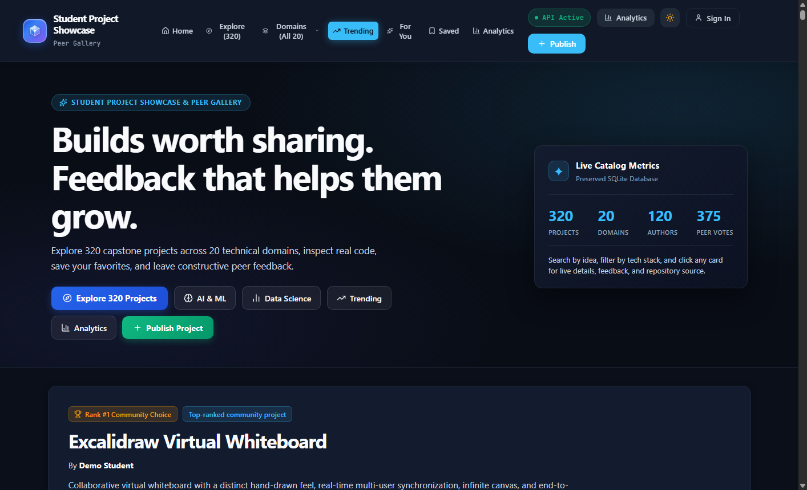
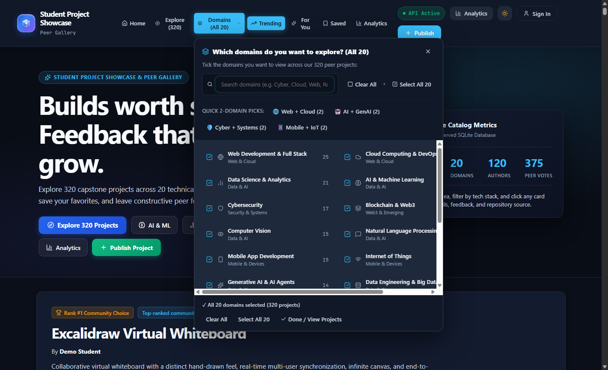
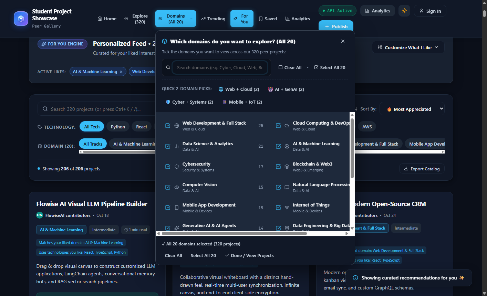
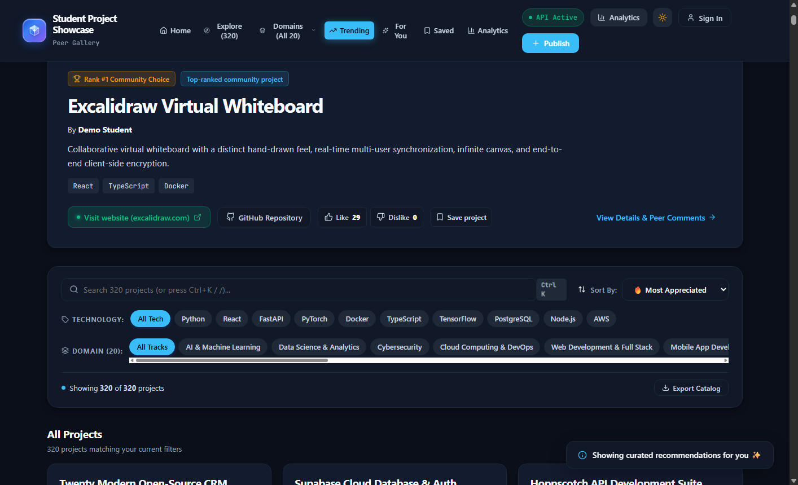
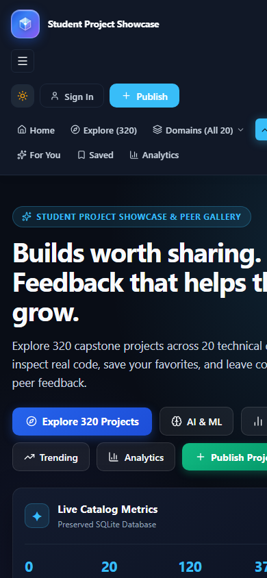
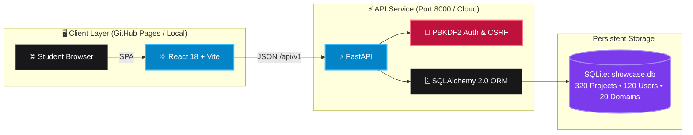

<a id="top"></a>

<div align="center">

<!-- ✨ Animated twinkling wave header -->
<a href="https://github.com/Dhruvi-tech/Student-Project-Showcase-and-Gallery">

</a>

<!-- ⌨️ Typing animation -->


<br/>

<sub>A cloud-native full-stack web platform for engineering students to **discover**, **review**, and **showcase** capstone projects across 20 technical domains.</sub>

<br/><br/>

<!-- 🧰 Tech stack icons -->


<br/><br/>

[](https://react.dev)
[](https://vitejs.dev)
[](https://fastapi.tiangolo.com)
[](https://python.org)
[](https://dhruvi-tech.github.io/Student-Project-Showcase-and-Gallery/)


[](https://github.com/Dhruvi-tech/Student-Project-Showcase-and-Gallery/stargazers)
[](https://github.com/Dhruvi-tech/Student-Project-Showcase-and-Gallery/forks)
[](https://github.com/Dhruvi-tech/Student-Project-Showcase-and-Gallery/issues)
[](https://github.com/Dhruvi-tech/Student-Project-Showcase-and-Gallery/commits/main)

<a href="https://dhruvi-tech.github.io/Student-Project-Showcase-and-Gallery/"><kbd>&nbsp;🌐 Open Live Web Application&nbsp;</kbd></a>
<a href="https://github.com/Dhruvi-tech/Student-Project-Showcase-and-Gallery"><kbd>&nbsp;📦 GitHub Repository&nbsp;</kbd></a>
<a href="https://github.com/Dhruvi-tech/Student-Project-Showcase-and-Gallery/issues"><kbd>&nbsp;🐞 Report Issue&nbsp;</kbd></a>
<a href="https://github.com/Dhruvi-tech/Student-Project-Showcase-and-Gallery/fork"><kbd>&nbsp;🍴 Fork Repository&nbsp;</kbd></a>

<br/>

<a href="#live-previews"><kbd>&nbsp;📸 Live Previews&nbsp;</kbd></a>
<a href="#highlights"><kbd>&nbsp;📊 Platform Stats&nbsp;</kbd></a>
<a href="#features"><kbd>&nbsp;✨ Key Features&nbsp;</kbd></a>
<a href="#how-it-works"><kbd>&nbsp;🧭 How It Works&nbsp;</kbd></a>
<a href="#architecture"><kbd>&nbsp;🏗️ Architecture&nbsp;</kbd></a>
<a href="#quickstart"><kbd>&nbsp;⚡ Quickstart&nbsp;</kbd></a>
<a href="#deployment"><kbd>&nbsp;🚀 Cloud Deployment&nbsp;</kbd></a>
<a href="#tracks"><kbd>&nbsp;🏷️ 20 Tracks&nbsp;</kbd></a>
<a href="#security"><kbd>&nbsp;🛡️ Security&nbsp;</kbd></a>
<a href="#structure"><kbd>&nbsp;📁 Structure&nbsp;</kbd></a>

</div>

<br/>

<a id="live-previews"></a>
<div align="center">

</div>

### 🌐 Live Deployment: [https://dhruvi-tech.github.io/Student-Project-Showcase-and-Gallery/](https://dhruvi-tech.github.io/Student-Project-Showcase-and-Gallery/)

Here are verified live screenshots captured directly from the production web application:

#### 1️⃣ Platform Home & Featured Capstone Spotlight
> The unified landing dashboard showcasing the **3D Innovation Prism Emblem**, real-time search (Ctrl+K), category filters, and the spotlight project.

<div align="center">
  
</div>

<br/>

#### 2️⃣ Interactive All 20 Technical Domains Popover
> Top navigation dropdown providing checkable tick boxes across all 20 technical domains, real-time domain search, 1-click **Clear All**, **Select All 20**, and quick 2-domain presets (Web+Cloud, AI+GenAI, Cyber+Systems, Mobile+IoT).

<div align="center">
  
</div>

<br/>

#### 3️⃣ Personalized "For You" Recommendations & Liked Topics Engine
> Interactive questionnaire asking which technical topics and programming stacks the student likes, calculating dynamic match scores across all 320 projects.

<div align="center">
  
</div>

<br/>

#### 4️⃣ Capstone Projects Grid & Peer Upvoting
> Responsive peer gallery cards displaying project difficulty tags, custom author names, peer appreciation counters, tech pills, and one-click comparison triggers.

<div align="center">
  
</div>

<br/>

#### 5️⃣ Mobile Responsive Experience
> Native mobile view with fluid layout, touch-friendly navigation, and adaptive modals.

<div align="center">
  
</div>

---

<a id="highlights"></a>
<div align="center">


<br/>

<table>
  <tr align="center">
    <td width="20%"><h1>📦</h1><br/><sub><b>Preserved Projects</b></sub></td>
    <td width="20%"><h1>👥</h1><br/><sub><b>Student Authors</b></sub></td>
    <td width="20%"><h1>👍</h1><br/><sub><b>Peer Upvotes</b></sub></td>
    <td width="20%"><h1>💬</h1><br/><sub><b>Review Comments</b></sub></td>
    <td width="20%"><h1>🏷️</h1><br/><sub><b>Technical Domains</b></sub></td>
  </tr>
</table>

</div>

---

<a id="features"></a>
<div align="center">

</div>

| Feature | Description | Capabilities |
| :--- | :--- | :--- |
| 🏷️ **Top 20 Engineering Domains Selector** | Interactive top navbar popover with multi-domain tick filtering | • Browse and tick any of the **20 technical domains** with live counts<br/>• **Instant Zero-Lag In-Memory Filtering**: 0 ms response without slow network spinners<br/>• **Clear All Option**: Unchecks all boxes while keeping projects visible (never blank)<br/>• **Select All 20**: 1-click select all 20 domains with 320 projects<br/>• **Quick 2-Domain Picks**: Web + Cloud, AI + GenAI, Cyber + Systems, Mobile + IoT |
| ✨ **Personalized "For You" Section** | Dedicated recommendation engine & interest questionnaire | • Interactive questionnaire asking what topics and tech stacks the student likes<br/>• 1-click presets (*Full-Stack & Cloud, Modern AI & ML, Systems & Security, Mobile & Smart Devices*)<br/>• Weighted recommendation match scores and explanation badges for every project |
| ✍️ **Custom Author Decision on Account Creation** | Personalized profile & capstone publishing attribution | • Creators decide their own **Author Display Name** and profile bio during registration<br/>• Published capstones proudly reflect the student's chosen name rather than a forced placeholder<br/>• Immediate synchronous session persistence in localStorage |
| 📊 **Tech Stack Analytics Command Center** | Interactive academic analytics & stack synergy hub | • Multi-column 1240px responsive grid with **Fullscreen Toggle** (`<Maximize2 />`)<br/>• **Domain Scope Drilldown**: filter metrics across all 320 projects or isolate any domain<br/>• **Architectural Synergy Matrix**: tech co-occurrence pairings (e.g. FastAPI + React)<br/>• Interactive SVG Donut chart for difficulty distribution |
| ⚖️ **Project Comparison Tray** | Multi-project side-by-side comparative inspector | • Select up to 3 capstone projects simultaneously via `[+ Compare]` buttons<br/>• Persistent floating bottom comparison dock with project badges<br/>• Direct attribute alignment: domain, difficulty, tech stack overlap, live demos, and source code |
| ⭐ **Academic Peer Review Rubric** | Structured multi-criteria evaluation | • 4 weighted evaluation rubrics: **Code Quality**, **Innovation**, **UI/UX Design**, and **Cloud Readiness**<br/>• Interactive 1-to-5 star rating picker for each rubric<br/>• Average score calculation with visual star badges in comment feed |
| 🔐 **Enterprise-Grade Security & PBKDF2 Auth** | Secure authentication and authorization | • PBKDF2-SHA256 password hashing with 310,000 iterations and unique cryptographic salt<br/>• Signed HttpOnly session cookies protecting against XSS attacks<br/>• Double-Submit CSRF cookie validation on all state-mutating requests<br/>• Strict server-side author ownership validation for edits and deletions |

---

<a id="how-it-works"></a>
<div align="center">

</div>

<div align="center">

| 🔎 **Discover** | 💬 **Review** | 👍 **Vote** | 🌟 **Showcase** |
| :---: | :---: | :---: | :---: |
| Browse and search 320+ projects filtered by 20 domains | Leave constructive peer feedback with 4-rubric ratings | Upvote the work that impresses you | Publish and manage your own capstone |
| ⬇️ | ⬇️ | ⬇️ | ⬇️ |
| *Open the details modal, compare, or view source* | *Authors read and learn from structured feedback* | *Top projects rise to the top* | *Only the author can edit or delete* |

</div>

---

<a id="architecture"></a>
<div align="center">

</div>



---

<a id="quickstart"></a>
<div align="center">

</div>

#### 0️⃣ Clone the Repository
```bash
git clone https://github.com/Dhruvi-tech/Student-Project-Showcase-and-Gallery.git
cd Student-Project-Showcase-and-Gallery
```

#### 1️⃣ Setup Dependencies
```bash
# Python Backend Dependencies
pip install -r backend/requirements.txt

# Node Frontend Dependencies
npm --prefix frontend install
```

#### 2️⃣ Start FastAPI Backend (Port 8000)
```powershell
# Windows PowerShell
cd backend
$env:DATABASE_URL = "sqlite:///../showcase.db"
$env:ENVIRONMENT = "development"
$env:DEMO_MODE = "true"
python -m uvicorn app.main:app --host 127.0.0.1 --port 8000 --reload
```

#### 3️⃣ Start React Frontend (Port 5173)
```powershell
# Windows PowerShell / macOS / Linux
cd frontend
npm run dev
```

#### 4️⃣ Build for Production
```bash
cd frontend
npm run build
```

---

<a id="tracks"></a>
<div align="center">

</div>

The platform catalogs **320 verified capstone projects** across 20 specialized engineering tracks:

| Domain | Projects | Track Group | Primary Technologies |
| :--- | :---: | :--- | :--- |
| 🌐 **Web Development & Full Stack** | 25 | Web & Cloud | React, Node.js, Next.js, Express, TailwindCSS |
| ☁️ **Cloud Computing & DevOps** | 23 | Web & Cloud | Docker, Kubernetes, AWS, Terraform, CI/CD |
| 📊 **Data Science & Analytics** | 21 | Data & AI | Python, Pandas, Scikit-Learn, PowerBI, SQL |
| 🤖 **AI & Machine Learning** | 19 | Data & AI | PyTorch, TensorFlow, Scikit-Learn, NumPy |
| 🛡️ **Cybersecurity** | 17 | Security & Systems | Cryptography, Wireshark, Snort, OAuth2, Linux |
| 📱 **Mobile App Development** | 15 | Mobile & Devices | Flutter, React Native, Kotlin, Swift, Android |
| 📡 **Internet of Things (IoT)** | 15 | Mobile & Devices | Raspberry Pi, ESP32, MQTT, Arduino, C++ |
| ⛓️ **Blockchain & Web3** | 15 | Web3 & Emerging | Solidity, Ethereum, IPFS, Smart Contracts, Web3.js |
| 👁️ **Computer Vision** | 15 | Data & AI | OpenCV, YOLO, PyTorch, MediaPipe, CNNs |
| 💬 **Natural Language Processing** | 15 | Data & AI | HuggingFace, Transformers, BERT, Spacy, NLTK |
| ✨ **Generative AI & AI Agents** | 14 | Data & AI | LangChain, LlamaIndex, OpenAI, ChromaDB, RAG |
| ⚙️ **Robotics & Automation** | 14 | Mobile & Devices | ROS2, Gazebo, Python, OpenCV, Inverse Kinematics |
| 🗄️ **Data Engineering & Big Data** | 14 | Data & AI | Apache Spark, Kafka, Airflow, dbt, PostgreSQL |
| 🛠️ **Software Engineering & Developer Tools** | 14 | Security & Systems | CLI tools, Linters, Testing Frameworks, Rust |
| 💳 **FinTech** | 14 | Industry Apps | Algorithmic Trading, Payment Gateways, Risk Analysis |
| 🏥 **HealthTech** | 14 | Industry Apps | Medical Imaging, Telehealth, BioInformatics, HL7 |
| 📚 **EdTech** | 14 | Industry Apps | LMS, Interactive Labs, Gamification, Quiz Engines |
| 🎮 **Game Development** | 14 | Media & 3D | Unity, Unreal Engine, Godot, C#, 3D Physics |
| 🥽 **AR/VR** | 14 | Media & 3D | WebXR, Three.js, Unity XR, Spatial Audio, Oculus |
| 🔧 **Open Source & Developer Utilities** | 14 | Security & Systems | SDKs, Documentation Generators, Git Utilities |

---

<a id="security"></a>
<div align="center">

</div>

| | Feature | Details |
| :---: | :--- | :--- |
| 🔑 | **Cryptographic Passwords** | PBKDF2-SHA256 with 310,000 rounds and unique cryptographic salt |
| 🍪 | **Signed HttpOnly Cookies** | Session tokens protected against XSS and tampering |
| 🛡️ | **Double-Submit CSRF** | Protection across all state-mutating requests (`POST`, `PUT`, `PATCH`, `DELETE`) |
| 👤 | **Ownership Enforcement** | Server-side author validation for project edit and delete actions |
| ☁️ | **Honest ₹0 Cloud Strategy** | Local zero-cost demonstration; AWS architectures (IAM, ECS, RDS, S3) prepared as IaC templates without unapproved cloud billing |

---

<a id="structure"></a>
<div align="center">

</div>

```text
Student-Project-Showcase-and-Gallery/
├── 🐍 backend/           # FastAPI application, SQLAlchemy models, Pydantic schemas, 30 tests
├── ⚛️  frontend/          # React 18 single-page application and responsive UI styles
│   ├── public/           # Static assets, SVG favicon
│   ├── src/
│   │   ├── components/   # Navbar, FilterBar, ProjectCard, ForYouPreferences, Modals
│   │   ├── data/         # staticCatalog.json (320 projects offline fallback)
│   │   └── services/     # api.js client service with CSRF & session handling
├── 📚 docs/              # Technical architecture, deployment specs, and live screenshots
│   └── screenshots/      # 5 verified live PNG screenshots of production application
├── ☁️  infra/             # Reference AWS CloudFormation and least-privilege IAM policies
├── 🐳 docker-compose.yml # Container orchestration configuration
├── ☁️  render.yaml        # 1-Click Cloud Deployment Blueprint (Render.com free tier)
├── 💾 showcase.db        # Preserved 320-project catalog database
└── 📖 README.md          # Comprehensive visual interactive documentation
```

<div align="center">

<br/>


<a href="#top"><kbd>&nbsp;⬆️ Back to top&nbsp;</kbd></a>


</div>
