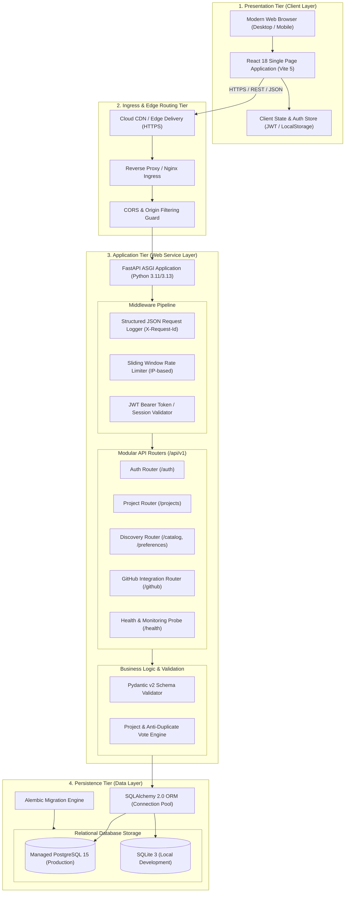
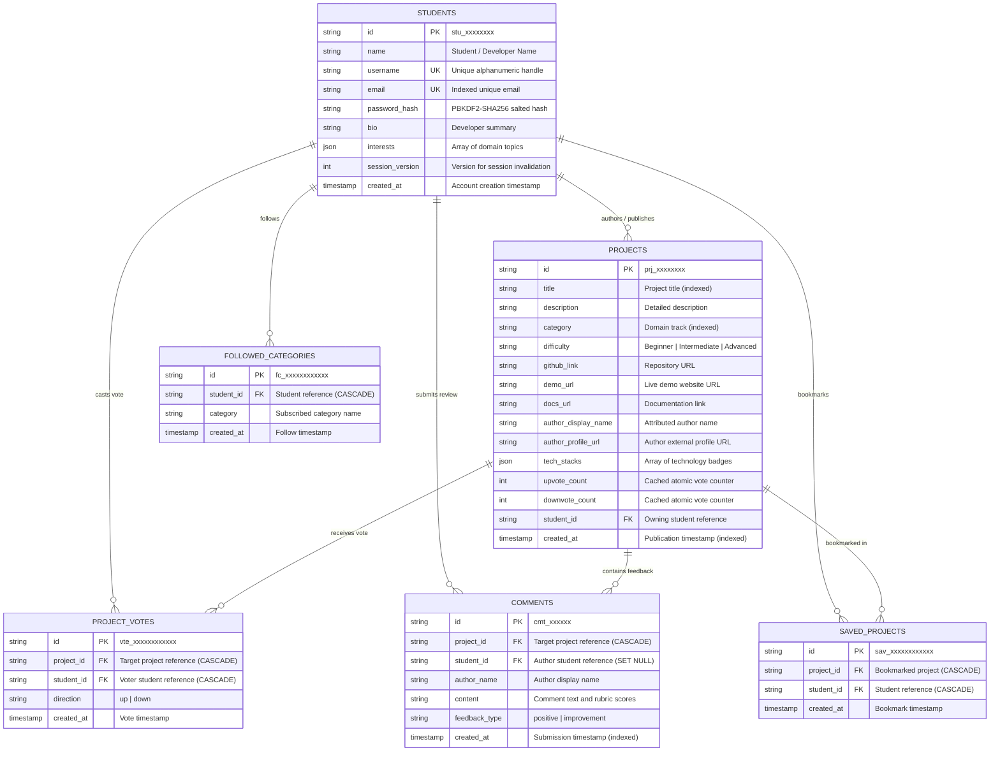
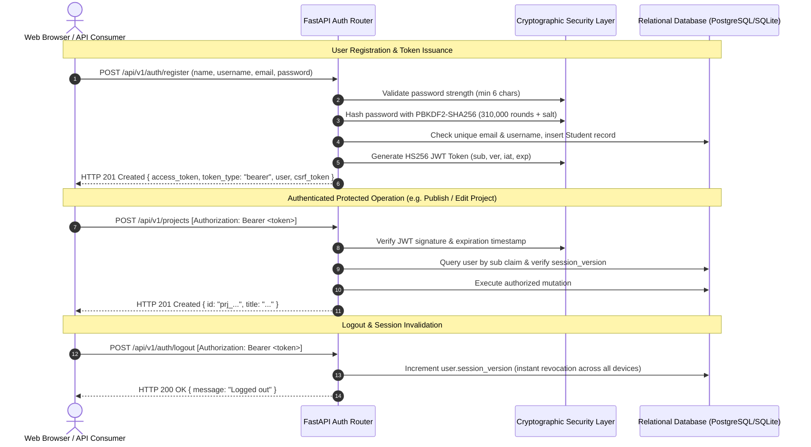

# System Architecture & Technical Specifications

**Course:** CS3302 — Development of Web Services  
**Project:** Student Project Showcase and Peer Gallery Platform  
**System Architecture Standard:** 3-Tier Cloud-Native Architecture with RESTful Services  

---

## 1. High-Level System Architecture

The platform follows a decoupled, multi-tier Service-Oriented Architecture (SOA) optimized for cloud deployment and high-concurrency read operations.

---

## 2. Multi-Tier Layer Decomposition

### 2.1 Presentation Tier (React 18 SPA)
- Built with React 18, Vite 5, Lucide React, and modern CSS Variables.
- Communicates exclusively through asynchronous JSON HTTP calls using standard REST endpoints.
- Maintains dual authentication resilience:
  - **Bearer Token**: Transmitted in the standard `Authorization: Bearer <token>` header for cross-origin and API-driven operations.
  - **HttpOnly Cookies**: Double-submit CSRF secured cookies for browser session persistence.
- Client-side routing with comprehensive fallback states (loading spinners, empty catalog notifications, error toasts, and field-level form validation).

### 2.2 Application Tier (FastAPI Web Service)
- High-performance, asynchronous REST web service leveraging ASGI (Uvicorn).
- Modular architecture cleanly dividing routers, schemas, models, and service business logic.
- Built-in OpenAPI 3.0 specification auto-generator exposing interactive Swagger UI (`/docs`) and ReDoc (`/redoc`).
- Structured logging pipeline emitting CloudWatch/Render-compatible JSON payloads with distributed request tracing (`X-Request-Id`).
- Lifespan context manager guaranteeing safe database initialization and non-destructive additive seed checks.

### 2.3 Persistence Tier (SQLAlchemy ORM & PostgreSQL / SQLite)
- Object-Relational Mapping (ORM) using SQLAlchemy 2.0 declarative models.
- Environment-driven database connection:
  - **Local Development**: Embedded SQLite (`sqlite:///./showcase.db`) with zero external dependency.
  - **Production Deployment**: Cloud-managed PostgreSQL 15 via `psycopg2-binary` connection pooling (`pool_pre_ping=True`, `pool_size=10`, `max_overflow=20`).
- Schema versioning managed via Alembic database migrations (`alembic/versions/`).

---

## 3. Database Schema & Entity Relationship Diagram (ERD)

The database schema enforces referential integrity, unique constraints, cascading deletions, and indexed lookups:

### Relational Constraints Enforced:
1. **Unique Vote Constraint**: `UNIQUE(project_id, student_id)` on `project_votes` prevents any user from casting duplicate votes across both up and down directions.
2. **Cascading Deletions**: Deleting a project automatically cascades to clean up associated comments, votes, and bookmarks without orphaned database rows.
3. **Atomic Counter Invariant**: `upvote_count` and `downvote_count` on `projects` are kept strictly synchronized with actual stored row counts in `project_votes`.

---

## 4. Authentication & Security Architecture

---

## 5. Architectural Evaluation: Monolithic vs. Microservices

In alignment with **Module 5: Microservices and Deployment of Web Services**, this project deliberately evaluates architectural patterns:

| Criterion | Modular Monolith (Implemented) | Microservices Architecture | Rationale for Choice |
|---|---|---|---|
| **Service Decomposition** | Modular domain decomposition inside one process (`auth`, `projects`, `discovery`, `github`). | Independent services across network boundaries (Auth Service, Catalog Service, Notification Service). | Prevents network hop latency and unnecessary distributed complexity for academic capstone scale while keeping clean domain boundaries. |
| **Data Consistency** | ACID relational transactions across projects, votes, and comments in a single database. | Eventual consistency, distributed transactions (Saga pattern), dual-write challenges. | Guarantees atomic anti-duplicate vote constraints and immediate consistency without complex distributed transaction orchestrators. |
| **Operational Overhead** | Single container deployment, unified logging, simple CI/CD. | Multiple container images, Kubernetes, service meshes, distributed tracing. | Extremely cost-effective (strict ₹0 cloud tier compliant), zero operational fragility. |
| **Scaling Characteristics** | Horizontal replication of stateless FastAPI containers behind a load balancer. | Independent scaling of high-traffic endpoints. | The read-heavy catalog pattern scales cleanly via horizontal PaaS replicas and connection pooling. |
