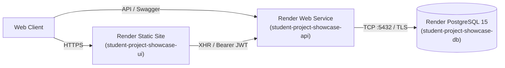

# Cloud Deployment & Infrastructure Guide

**Course:** CS3302 — Development of Web Services  
**Target Environments:**
1. **Render PaaS** (Managed PostgreSQL 15 + FastAPI Web Service + React Static Site)
2. **GitHub Pages** (Public Static Deployment of React SPA)
3. **Docker & Docker Compose** (Local Containerized Multi-Tier Environment)

---

## 1. Cloud Architecture Overview (Render.com)

The project leverages a 1-Click declarative infrastructure Blueprint defined in [`render.yaml`](file:///render.yaml):



---

## 2. Render 1-Click Cloud Deployment Instructions

### Prerequisites
- A free Render.com account (sign up at [https://render.com](https://render.com)).
- Access to the GitHub repository: `https://github.com/Dhruvi-tech/Student-Project-Showcase-and-Gallery`.

### Step-by-Step Blueprint Provisioning:
1. Log into your [Render Dashboard](https://dashboard.render.com).
2. Click **New +** at the top right, then select **Blueprint**.
3. Connect your GitHub account and select repository:
   `Dhruvi-tech/Student-Project-Showcase-and-Gallery`
4. Render automatically parses the root [`render.yaml`](file:///render.yaml) file and presents the three services to be provisioned:
   - **Database:** `student-project-showcase-db` (PostgreSQL 15, Free tier)
   - **Web Service:** `student-project-showcase-api` (Python, Free tier)
   - **Static Site:** `student-project-showcase-ui` (React 18 / Vite 5, Free tier)
5. Click **Apply**.
6. Render provisions the resources in order:
   - First, the PostgreSQL managed database is spun up and assigned an internal connection string.
   - Second, the web service builds using `pip install -r backend/requirements.txt`, binds dynamically to `$PORT`, runs database table creation, seeds initial catalog if empty, and initializes health checks.
   - Third, the static site executes `npm install && npm run build` and serves the production distribution from `frontend/dist`.

### Production Environment Variables Handled Automatically:
| Variable | Injected Source | Purpose |
|---|---|---|
| `DATABASE_URL` | `fromDatabase: student-project-showcase-db` | Connection string with username, password, host, port, database |
| `AUTH_SECRET` | `generateValue: true` | Render generates a unique 64-character cryptographic secret |
| `ENVIRONMENT` | `production` | Enables production mode and security strictness |
| `DEMO_MODE` | `false` | Enforces real authentication and rejects spoofed headers |
| `CORS_ORIGINS` | `https://student-project-showcase-ui.onrender.com,https://dhruvi-tech.github.io,...` | Restricts allowed origins strictly |
| `VITE_API_URL` | `https://student-project-showcase-api.onrender.com` | Configures React client to point to backend |

---

## 3. GitHub Pages Deployment

The frontend single-page application is also continuously published to GitHub Pages:
- **Live URL:** `https://dhruvi-tech.github.io/Student-Project-Showcase-and-Gallery/`
- **Source Branch:** `gh-pages`
- **Workflow Automation:** `.github/workflows/deploy-pages.yml` triggers on push to `main`, builds the latest bundle, prepares `404.html` and `.nojekyll` for client-side routing, and commits to the `gh-pages` branch.

### Manual Direct Deployment to GitHub Pages:
```powershell
cd frontend
npm run build
Copy-Item dist\index.html dist\404.html
New-Item -ItemType File -Path dist\.nojekyll -Force
# Commit and push dist to gh-pages branch
```

---

## 4. Local Containerized Deployment (Docker Compose)

The multi-tier architecture can be executed locally in identical containerized parity:

### Commands:
```bash
# 1. Clone repository
git clone https://github.com/Dhruvi-tech/Student-Project-Showcase-and-Gallery.git
cd Student-Project-Showcase-and-Gallery

# 2. Build and start all 3 tiers (DB, Backend, Frontend)
docker compose up --build -d

# 3. Verify container health status
docker compose ps

# 4. View real-time logs
docker compose logs -f backend
```

### Local Container Endpoints:
- **Frontend Gallery UI:** `http://localhost:5173`
- **FastAPI REST API:** `http://localhost:8000`
- **Interactive Swagger Docs:** `http://localhost:8000/docs`
- **ReDoc Documentation:** `http://localhost:8000/redoc`
- **Health Probe:** `http://localhost:8000/health`
- **PostgreSQL Database:** `localhost:5432` (`showcase_db`, user: `postgres`, password: `postgres`)

---

## 5. Database Persistence & Migration Management

### Dual Dialect Persistence Strategy:
- **Local Dev:** SQLite file (`showcase.db`) is preserved for lightweight zero-cost testing.
- **Production / Docker:** PostgreSQL 15 persistent disk volume (`showcase_postgres_data` or Render Managed Disk).

### Alembic Migrations:
The project uses Alembic for declarative schema tracking:
```bash
cd backend

# View migration history
alembic history

# Apply migrations to target database
alembic upgrade head

# Generate a new migration revision
alembic revision --autogenerate -m "add_new_feature_table"
```

### Non-Destructive Safe Seeding Strategy:
When the backend boots (`lifespan` in `app/main.py`), it checks whether any projects exist:
- If `db.query(Project).count() == 0`, it invokes `seed_database(reset=False)` once.
- If projects already exist, it immediately skips seeding to prevent overwriting user modifications or slowing down service restarts.

---

## 6. Production Troubleshooting & Verification

| Issue | Root Cause | Solution |
|---|---|---|
| **CORS Blocked (Cross-Origin Request Blocked)** | Frontend origin not present in backend allowlist. | Ensure backend environment variable `CORS_ORIGINS` includes exact frontend domain (including protocol and port, without trailing slash). |
| **Render Cold Start Delay** | Free tier spin-down after 15 minutes of inactivity. | First request may take 30-50 seconds while container boots. Healthcheck will show 200 once active. |
| **Database Connectivity Failure** | Incompatible connection string format or missing SSL parameter. | Render PostgreSQL uses internal DNS inside Render network. Ensure `psycopg2-binary` is installed and `DATABASE_URL` is passed via `fromDatabase`. |
| **Client-Side 404 on Refresh in SPA** | Web server does not rewrite unknown paths to `index.html`. | Verify `routes: [{ type: rewrite, source: /*, destination: /index.html }]` is configured in `render.yaml` or `404.html` exists on GitHub Pages. |
