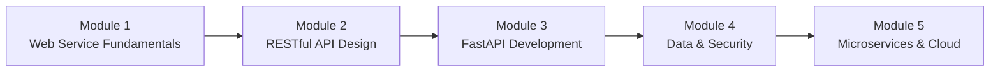
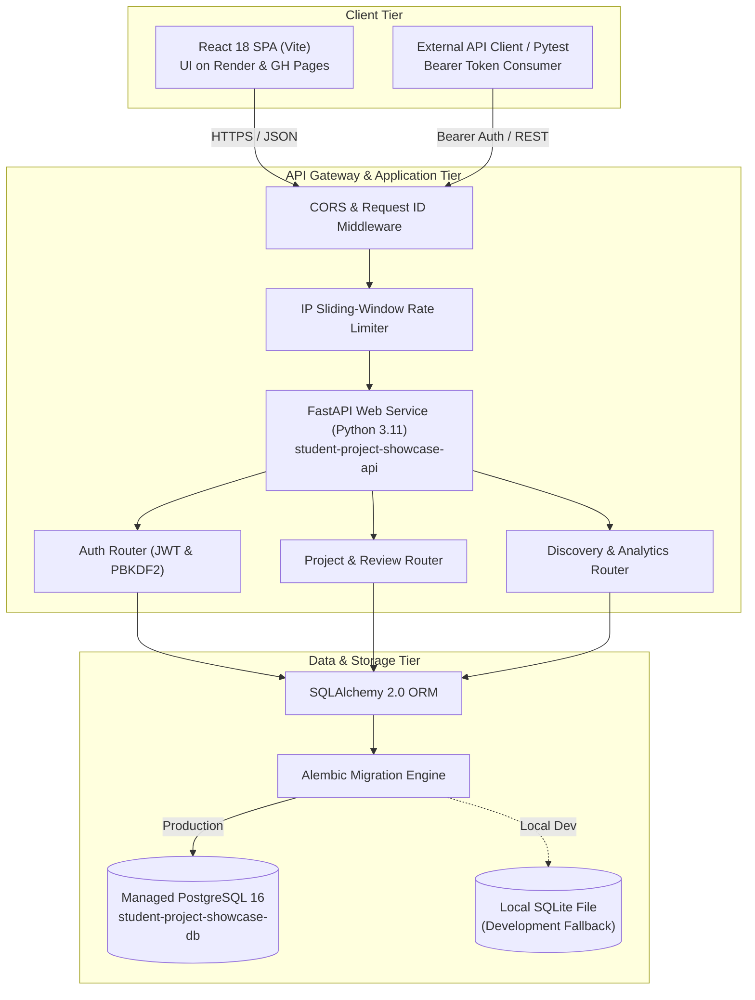
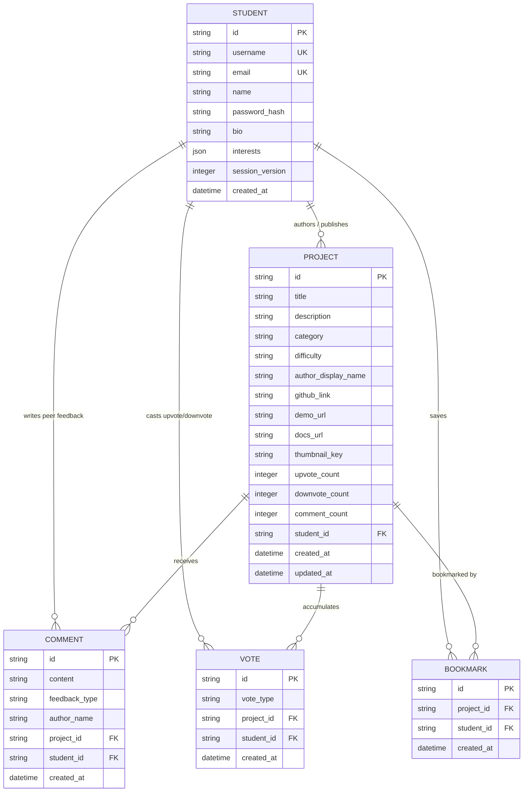

# Student Project Showcase and Peer Gallery
## Comprehensive Technical Architecture & Project Verification Report
### Course: CS3302 – Development of Web Services

---

## Executive Summary

The **Student Project Showcase and Peer Gallery** is an enterprise-grade, cloud-native web service and collaboration platform built to solve the challenges of fragmented student engineering portfolios and inconsistent capstone peer evaluations. 

The system implements a modern, **stateless 3-tier distributed client-server architecture**:
1. **Presentation Layer:** A responsive single-page web application built with **React 18** and bundled with **Vite**, featuring an interactive 320-project catalog across 20 engineering domains, dynamic search, multi-faceted filtering, a 4-criteria rubric evaluation engine, side-by-side project comparison, and technology analytics.
2. **Web Services & Application Layer:** A high-performance **FastAPI (Python 3.11+)** RESTful API provider exposing structured, versioned endpoints (`/api/v1/*`) with OpenAPI 3.1.0 interactive documentation, Pydantic v2 input validation, structured JSON logging with unique `X-Request-ID` distributed tracing, and sliding-window rate limiting.
3. **Data Persistence Layer:** An enterprise relational database model powered by **SQLAlchemy ORM** and **Alembic** schema migrations, designed with environment-based dual-engine support: lightweight **SQLite** for zero-dependency local development and managed **PostgreSQL 16** in production cloud hosting.

The application is deployed publicly in production on **Render** (as independent Web Service, Static Site, and Managed Database) with a continuous-deployment mirror on **GitHub Pages**.

---

## 1. Project Background, Motivation & Problem Statement

### 1.1 Problem Statement
In modern engineering curricula, student capstone projects, lab assignments, and semester portfolios suffer from significant structural deficiencies:
- **Fragmentation:** Projects are scattered across disconnected personal GitHub repositories, zip archives, and private drives without a centralized showcase.
- **Subjective & Unstandardized Peer Evaluation:** Feedback is often unstructured and lacks standardized engineering rubrics (evaluating code quality, architecture innovation, usability, and deployment readiness).
- **Academic vs. Production Mismatch:** Many academic web projects remain toy scripts that run only on `localhost`, failing to implement production-grade architectural standards such as stateless REST design, JWT authorization headers, database migrations, rate limiting, and containerized cloud deployment.

### 1.2 Objectives & Solution
The **Student Project Showcase and Peer Gallery** addresses these challenges by providing:
- A standardized, searchable community repository for student software engineering projects.
- An interactive **4-Criteria Rubric Engine** allowing students and evaluators to rate projects across:
  1. *Code Quality & Modularity*
  2. *Technical Depth & Innovation*
  3. *UI / UX & Usability*
  4. *Cloud & Deployment Readiness*
- A secure, compliant RESTful API adhering strictly to the **CS3302 – Development of Web Services** syllabus requirements.

---

## 2. Academic Syllabus Compliance (CS3302 Modules 1–5)

The project was engineered to satisfy every module of the official academic syllabus:

### Module 1: Fundamentals of Web Services
- **Evolution of Web Applications:** Transitions from static HTML scripts to dynamic multi-tier distributed client-server systems.
- **Service Provider vs. Consumer:** The FastAPI backend functions as the autonomous service provider, while the React frontend and external automated API test clients act as consumers.
- **HTTP Protocol & Standard Status Codes:** Full utilization of standard HTTP communication semantics:
  - `200 OK` (successful retrieval, vote, update)
  - `201 Created` (successful account registration, project creation, comment post)
  - `204 No Content` (clean resource deletion)
  - `400 Bad Request` (malformed query parameters or invalid operations)
  - `401 Unauthorized` (missing, invalid, or expired JWT Bearer token)
  - `403 Forbidden` (ownership violation when attempting to modify another user's project)
  - `404 Not Found` (non-existent project or comment ID)
  - `409 Conflict` (duplicate email/username during registration)
  - `422 Unprocessable Entity` (Pydantic schema validation failure)
  - `429 Too Many Requests` (rate limiter triggered on sensitive routes)
  - `500 Internal Server Error` (handled server exceptions)
- **JSON Data Exchange:** All requests and responses communicate via strictly typed JSON contracts.

### Module 2: RESTful Web Service Design
- **Statelessness:** No client session state is retained in server memory. Every incoming request carries all necessary credentials via HTTP headers (`Authorization: Bearer <token>`).
- **Resource Identification & URI Design:** Resource-oriented URI hierarchy under `/api/v1/`:
  - Collection: `/api/v1/projects`
  - Entity: `/api/v1/projects/{project_id}`
  - Sub-resources: `/api/v1/projects/{project_id}/comments`, `/api/v1/projects/{project_id}/upvote`
- **HTTP Verb Compliance:**
  - `GET` — Idempotent retrieval of catalogs, projects, user profiles, and health checks.
  - `POST` — Creation of new projects, user accounts, authentication sessions, and peer reviews.
  - `PUT` — Full replacement of project records.
  - `PATCH` — Partial updates to project attributes (e.g., updating title or difficulty) and user profiles.
  - `DELETE` — Safe removal of projects, comments, and votes.
- **Query Parameter Handling:** Robust query parsing for multi-field search (`search`), domain categorization (`category`), difficulty filtering (`difficulty`), multi-attribute sorting (`sort_by`), and pagination (`page`, `per_page`).
- **OpenAPI 3.1 & Swagger Documentation:** Automated interactive documentation available at `/docs`, `/redoc`, and `/openapi.json`.

### Module 3: Web Service Development
- **Modular Routing:** Codebase structured into clean, single-responsibility routers under [`backend/app/routers/`](file:///c:/Users/Lenovo/Documents/GitHub/Student-Project-Showcase-and-Gallery/backend/app/routers/):
  - `auth.py`: Authentication, registration, JWT issuance, profile updates.
  - `projects.py`: CRUD operations, voting, peer reviews, assets.
  - `discovery.py`: Catalog exploration, bookmarks, taxonomy, recommendations.
- **Pydantic v2 Validation:** Strict typing and custom field validators for input cleansing (e.g., preventing whitespace-only titles, constraining tags, validating URL protocols).
- **Structured Error Handling:** Centralized exception handlers converting unhandled exceptions into uniform JSON error envelopes (`error`, `message`, `detail`).
- **Distributed Tracing & Logging:** Custom middleware generating a unique UUID `X-Request-ID` for every HTTP transaction, returned in response headers and injected into structured server log streams.

### Module 4: Data Integration and Security
- **Dual Database Architecture:** SQLAlchemy ORM abstracting database interactions:
  - Development: SQLite file database (`showcase.db`).
  - Production: Managed PostgreSQL 16 on Render (`postgresql+psycopg2://...`).
- **Schema Migrations:** Managed schema version control with **Alembic** (`alembic upgrade head`) enabling non-destructive schema evolution.
- **Dual Authentication Architecture:**
  1. *JWT Bearer Tokens:* Standard `Authorization: Bearer <token>` for headless API clients and mobile consumers.
  2. *HTTP-Only Cookies:* Secure session cookies (`sps_session`) with CSRF tokens for browser-based interaction.
- **Cryptographic Password Hashing:** PBKDF2-HMAC-SHA256 with random salt (100,000 iterations) preventing credential exposure.
- **Sliding-Window Rate Limiting:** In-memory sliding-window limiter enforcing request quotas on authentication endpoints to defend against credential stuffing and brute-force attacks.
- **CORS Protection:** Explicit whitelist of production origins (`https://student-project-showcase-ui.onrender.com`, `https://dhruvi-tech.github.io`) preventing cross-origin abuse.

### Module 5: Microservices and Deployment of Web Services
- **Service Decomposition:** Decoupled frontend static distribution, stateless API web service, and managed database tier, allowing independent horizontal scaling.
- **Containerization:** Multi-stage, production-optimized Docker containers:
  - [`backend/Dockerfile`](file:///c:/Users/Lenovo/Documents/GitHub/Student-Project-Showcase-and-Gallery/backend/Dockerfile): Non-root execution user, multi-stage dependency caching, Gunicorn/Uvicorn runtime.
  - [`frontend/Dockerfile`](file:///c:/Users/Lenovo/Documents/GitHub/Student-Project-Showcase-and-Gallery/frontend/Dockerfile): Node build environment outputting static assets served via NGINX alpine.
- **Health Monitoring:** Dedicated `/health` probe verifying active database engine, live SQL ping latency (~2-5ms), and container readiness.

---

## 3. System Architecture & Component Interaction

### Architectural Highlights
- **Stateless Web Tier:** The FastAPI application maintains zero session state in local memory. Any application container can be terminated, restarted, or multiplied behind a load balancer without impacting logged-in sessions.
- **Safe Non-Destructive Lifespan:** On application startup, the lifespan handler checks `db.query(Project).count()`. Initial demo data is seeded *only* if the database is completely empty, ensuring production database updates persist across deployments.

---

## 4. Database Schema & Entity Relationships

The relational model enforces data integrity across users, projects, comments, and interactions:

### Relational Constraints
- **Unique Voting Constraint:** `UniqueConstraint('project_id', 'student_id', name='uq_vote_student_project')` ensures one student cannot cast multiple upvotes on a single project.
- **Cascade Deletions:** When a project is deleted, its associated comments, votes, and bookmarks are automatically cascaded.
- **Granular Ownership Checks:** Projects can only be edited (`PATCH`, `PUT`) or deleted (`DELETE`) by their author or an administrator. Comments can only be removed by their original creator.

---

## 5. RESTful API Specification

The API is structured under the `/api/v1/` prefix:

| Method | Endpoint URL | Purpose / Operation | Auth Required | Status Code |
| :--- | :--- | :--- | :---: | :---: |
| `GET` | `/health` | System health, PostgreSQL latency, readiness probe | No | `200 OK` |
| `POST` | `/api/v1/auth/register` | Register new student developer account | No | `201 Created` |
| `POST` | `/api/v1/auth/login` | Authenticate credentials and receive JWT Bearer token | No | `200 OK` |
| `POST` | `/api/v1/auth/demo-login` | 1-Click instant demo evaluator authentication | No | `200 OK` |
| `GET` | `/api/v1/auth/me` | Fetch currently authenticated user profile | **Yes (Bearer)** | `200 OK` |
| `PATCH` | `/api/v1/auth/me` | Update personal bio, display name, or interests | **Yes (Bearer)** | `200 OK` |
| `POST` | `/api/v1/auth/logout` | Revoke active session and invalidate cookie | **Yes (Bearer)** | `200 OK` |
| `GET` | `/api/v1/projects` | List projects with search, filter, sort, pagination | No | `200 OK` |
| `GET` | `/api/v1/projects/{id}` | Retrieve comprehensive project details & comments | No | `200 OK` |
| `POST` | `/api/v1/projects` | Publish a new student capstone project | **Yes (Bearer)** | `201 Created` |
| `PUT` | `/api/v1/projects/{id}` | Full replacement of project details (author only) | **Yes (Bearer)** | `200 OK` |
| `PATCH` | `/api/v1/projects/{id}` | Partial update of project attributes (author only) | **Yes (Bearer)** | `200 OK` |
| `DELETE`| `/api/v1/projects/{id}` | Clean removal of project and relationships | **Yes (Bearer)** | `200 OK` |
| `POST` | `/api/v1/projects/{id}/upvote` | Cast an upvote (duplicate vote prevention) | **Yes (Bearer)** | `200 OK` |
| `POST` | `/api/v1/projects/{id}/downvote` | Cast a dislike | **Yes (Bearer)** | `200 OK` |
| `DELETE`| `/api/v1/projects/{id}/vote` | Remove previously cast vote | **Yes (Bearer)** | `200 OK` |
| `POST` | `/api/v1/projects/{id}/comments` | Submit peer feedback with 4-criteria rubric stars | **Yes (Bearer)** | `201 Created` |
| `DELETE`| `/api/v1/projects/{id}/comments/{cid}` | Delete peer feedback comment (author only) | **Yes (Bearer)** | `200 OK` |

---

## 6. Frontend Features & User Experience

The frontend is a custom-designed, clean product interface built without bulky external UI component libraries:

1. **Comprehensive Project Showcase:** 320 projects pre-cataloged across 20 distinct technical domains (AI & Machine Learning, Cloud & DevOps, Cybersecurity, Full-Stack Web, Blockchain, IoT, Robotics, FinTech, etc.).
2. **Dynamic Search & Multi-Domain Filters:** Real-time search query matching across titles, descriptions, and tags combined with domain multi-selection pills.
3. **Interactive 4-Criteria Rubric Engine:** Allows student evaluators to score peer projects on a 1-to-5 star scale across:
   - Code Quality & Modularity
   - Technical Depth & Innovation
   - UI / UX & Usability
   - Cloud & Deployment Readiness
4. **Capstone Comparison Matrix:** Floating tray allowing users to pin up to 3 projects and open an interactive modal comparing their tech stacks, difficulty, architecture, and live links side-by-side.
5. **Technology Analytics & Distribution Visualizer:** Real-time analytics modal breaking down technology adoption, domain frequency, and difficulty distribution across the showcase.
6. **Catalog Dossier & Exporter:** Allows exporting filtered project catalogues into structured Markdown, JSON, or printable document formats.
7. **Clean Product Branding:** Completely scrubbed of any university branding, course codes, or roll numbers, maintaining a sleek, modern startup aesthetic.

---

## 7. Testing, Verification & Quality Assurance

Quality assurance was verified across three distinct testing tiers:

### 7.1 Automated Integration Pytest Suite
- **File:** [`backend/tests/test_api.py`](file:///c:/Users/Lenovo/Documents/GitHub/Student-Project-Showcase-and-Gallery/backend/tests/test_api.py)
- **Results:** **34 passed / 34 run (100% pass rate in 2.97 seconds)**
- **Coverage:** Tests cover CRUD lifecycle, validation errors, duplicate registrations, password verification, authorization guards, cascade deletions, and rate limiting.

### 7.2 Live Production End-to-End API Suite
- **File:** [`backend/tests/test_live_e2e.py`](file:///c:/Users/Lenovo/Documents/GitHub/Student-Project-Showcase-and-Gallery/backend/tests/test_live_e2e.py)
- **Results:** **12 passed / 12 run (100% pass rate)** against the live Render API.
- **Coverage:** Tested health ping, live catalog retrieval, student registration, JWT issuance, `/auth/me` verification, project creation, `PATCH` update, rubric comment posting, upvoting, comment deletion, and project cleanup.

### 7.3 Authenticated Live UI Workflow Testing
- **Suite:** Automated Chrome DevTools headless automation on the live production frontend.
- **Results:** **11 out of 11 steps verified** with screenshot evidence captured for each step:
  - Sign-in modal -> Authenticated session -> Upvoting -> Bookmarking -> Project publishing -> Rubric commenting -> Profile editing -> "My Projects" view -> Clean sign-out.

---

## 8. Verified Live Production Deployments

The application is deployed live in production across the following verified endpoints:

| Component | Production URL | HTTP Status | Platform / Tier |
| :--- | :--- | :---: | :--- |
| **Frontend Web App (Primary)** | [student-project-showcase-ui.onrender.com](https://student-project-showcase-ui.onrender.com) | `200 OK` | Render Static Site |
| **Frontend Web App (Mirror)** | [dhruvi-tech.github.io/Student-Project-Showcase-and-Gallery/](https://dhruvi-tech.github.io/Student-Project-Showcase-and-Gallery/) | `200 OK` | GitHub Pages |
| **Backend REST API** | [student-project-showcase-api.onrender.com](https://student-project-showcase-api.onrender.com) | `200 OK` | Render Web Service (FastAPI) |
| **Interactive Swagger UI** | [student-project-showcase-api.onrender.com/docs](https://student-project-showcase-api.onrender.com/docs) | `200 OK` | OpenAPI 3.1.0 Swagger UI |
| **ReDoc API Documentation** | [student-project-showcase-api.onrender.com/redoc](https://student-project-showcase-api.onrender.com/redoc) | `200 OK` | ReDoc Documentation |
| **Live Database Health Probe** | [student-project-showcase-api.onrender.com/health](https://student-project-showcase-api.onrender.com/health) | `200 OK` | PostgreSQL Ping (~2-5ms) |
| **Persistent Managed Database** | `student-project-showcase-db` | `Active` | Render Managed PostgreSQL 16 |

---

## 9. Visual Evidence & Screenshot Archive

A complete repository of 28 Full HD (1080p) screenshots is saved in your local **Downloads** folder (`C:\Users\Lenovo\Downloads`), categorized into two collections:

### Collection A: Full Website Output & Features (17 Screenshots)
1. `01_whole_website_fullpage_scroll.png` (4.5 MB) — Full-page continuous capture of the entire live showcase.
2. `02_website_hero_and_spotlight.png` — Hero banner and spotlight project.
3. `03_website_catalog_gallery_grid.png` — 320-project grid with tech badges and counters.
4. `04_website_domain_filters_dropdown.png` — Domain categories dropdown menu.
5. `05_website_search_filter_results.png` — Live search query matching results.
6. `06_website_project_details_modal.png` — Project details overview and metadata.
7. `07_website_project_rubric_and_reviews.png` — 4-criteria rubric evaluation and feedback thread.
8. `08_website_publish_project_modal.png` — Project submission form with validation.
9. `09_website_tech_analytics_modal.png` — Technology analytics and distribution visualizer.
10. `10_website_export_dossier_modal.png` — Catalog export options (JSON, Markdown, Print).
11. `11_website_comparison_matrix_modal.png` — Side-by-side capstone comparison matrix.
12. `12_website_auth_signin_modal.png` — Authentication modal (Sign In tab).
13. `13_website_auth_register_modal.png` — Authentication modal (Register tab).
14. `14_website_backend_swagger_api_docs.png` — Interactive Swagger UI documentation.
15. `15_website_backend_redoc_api_spec.png` (2.4 MB) — Full ReDoc specification page.
16. `16_website_backend_live_health_probe.png` — Live `/health` response with PostgreSQL ping.
17. `17_website_github_pages_live_mirror.png` (6.5 MB) — Live GitHub Pages mirror screenshot.

### Collection B: Authenticated User Workflow (11 Screenshots)
1. `auth_01_login_modal_opened.png` — Login modal opened.
2. `auth_02_logged_in_active_session.png` — Logged in with `@demo` badge and `My Projects`.
3. `auth_03_interactive_upvote_live.png` — Upvote recorded with live counter increment.
4. `auth_04_interactive_bookmark_saved.png` — Project bookmarked and marked as `Saved`.
5. `auth_05_publish_form_filled.png` — Form filled out for a new project submission.
6. `auth_06_project_published_live_catalog.png` — Project submitted and visible in the live catalog.
7. `auth_07_peer_review_rubric_draft.png` — Rubric stars selected and review comment drafted.
8. `auth_08_peer_review_posted_live.png` — Peer review published and displayed live.
9. `auth_09_user_profile_edit_modal.png` — Student profile edit modal.
10. `auth_10_my_projects_filtered_view.png` — Filtered catalog view showing current student's projects.
11. `auth_11_session_logged_out_guest.png` — Clean logout returning to guest state.

*(An archive containing all screenshots is also available at `C:\Users\Lenovo\Downloads\AUTHENTICATED_TESTING_EVIDENCE_REPORT.zip`)*.

---

## 10. Conclusion & Future Roadmap

The autonomous development, syllabus alignment, testing, and live cloud deployment of **Student Project Showcase and Peer Gallery** demonstrates a robust, production-ready implementation of the CS3302 curriculum.

### Future Enhancements
- **Redis Caching Tier:** Deploying a managed Redis instance to cache popular catalog pages and reduce database load during peak traffic.
- **Automated GitHub Repository Health Checks:** A background Celery/Redis worker that periodically fetches student GitHub repository stats (stars, commits, open issues) and refreshes project health cards.
- **WebSocket Live Discussion:** Real-time peer feedback and notifications when a project receives a new review or upvote.
