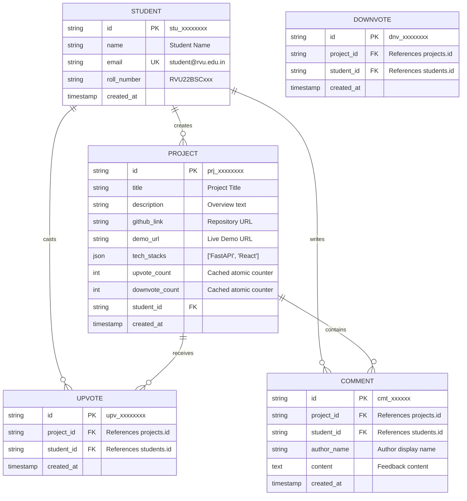

# System Architecture & Cloud Design (Session 36)
## Course: CS3452 — Cloud Platforms and Service Models
### Project: Student Project Showcase and Peer Gallery API

---

### 1. Cloud-Native Architectural Overview

The application follows a **modern 3-Tier Cloud-Native Architecture** optimized for PaaS (Platform as a Service) and Container-as-a-Service (CaaS) hosting.

```mermaid
flowchart TD
    subgraph ClientLayer ["1. Client & Presentation Layer"]
        Browser["React 18 SPA (Vite / Desktop & Mobile Browser)"]
        PersonaSelector["Student Identity Switcher (Phase 1 Dev Persona)"]
        Browser --- PersonaSelector
    end

    subgraph EdgeLayer ["2. Cloud Edge & Ingress Layer (PaaS / Gateway)"]
        LB["Cloud Load Balancer / Nginx Ingress"]
        HealthProbe["Liveness & Readiness Probe (/health)"]
        LB --> HealthProbe
    end

    subgraph ComputeLayer ["3. Application Backend Layer (Containerized PaaS)"]
        subgraph FastAPIContainer ["FastAPI + Uvicorn Container (Stateless)"]
            Router["API Router (/api/v1)"]
            Validation["Pydantic v2 Schema Validator"]
            Service["Business Logic & Anti-Duplicate Vote Engine"]
            ORM["SQLAlchemy ORM (Connection Pool)"]
            Router --> Validation --> Service --> ORM
        end
    end

    subgraph StorageLayer ["4. Cloud Managed Storage Layer"]
        subgraph RelationalDB ["Managed Relational Database (PostgreSQL 15)"]
            StudentsTbl[("students (id, name, email)")]
            ProjectsTbl[("projects (id, title, upvote_count, downvote_count)")]
            UpvotesTbl[("upvotes (UNIQUE: project_id + student_id)")]
            DownvotesTbl[("downvotes (UNIQUE: project_id + student_id)")]
            CommentsTbl[("comments (id, project_id, content)")]
            ProjectsTbl --- UpvotesTbl
            ProjectsTbl --- DownvotesTbl
            ProjectsTbl --- CommentsTbl
            StudentsTbl --- ProjectsTbl
        end
        subgraph ObjectStorage ["Future Cloud Storage (Phase 2 Preparation)"]
            S3["Amazon S3 / Azure Blob (Project Screenshots & Assets)"]
        end
    end

    Browser -->|HTTP/JSON| LB
    LB -->|Reverse Proxy :8000| Router
    ORM -->|TCP 5432 / Connection Pool| RelationalDB
    FastAPIContainer -.->|Pre-Signed URLs (Phase 2)| S3
```

---

### 2. Cloud Service Models Comparative Analysis

In accordance with Module 1, Module 2, and Module 3 of the CS3452 curriculum:

| Service Model | Implementation Option | Pros | Cons | Recommendation |
|---|---|---|---|---|
| **IaaS** (Infrastructure as a Service) | Standalone EC2 / Azure VM running Ubuntu, manual Nginx + Postgres installation | Full OS control, custom kernel tweaks | High operational overhead, manual security patching, complex auto-scaling | Not recommended for modern microservice |
| **PaaS / CaaS** (Platform as a Service) | **AWS App Runner / Azure App Service / GCP Cloud Run** running Docker container | Zero OS maintenance, automated horizontal auto-scaling, integrated TLS/SSL, pay-for-compute | Slightly less low-level OS tuning | **PRIMARY CHOICE for Showcase API** |
| **Serverless / FaaS** | AWS Lambda + API Gateway | Scales to zero, zero idle cost | Cold starts on Python runtimes, connection pooling limits on relational DBs | Planned for async event triggers in Phase 2 |
| **Managed DB** (DBaaS) | **AWS RDS for PostgreSQL / Azure Database for PostgreSQL** | Automated multi-AZ backups, read replicas, automated minor version upgrades | Requires VPC network peering | **PRIMARY CHOICE for Database** |

---

### 3. Database Schema & Relational Integrity



#### Enforcing the Single-Upvote Rule at the Database Engine
The `upvotes` table defines:
```sql
UNIQUE CONSTRAINT uq_project_student_upvote (project_id, student_id);
```
Even if a student client attempts multiple simultaneous HTTP requests (e.g. double-clicking rapidly or script automation), the database engine rejects duplicate inserts with an `IntegrityError`, ensuring zero race-condition vote duplication.

---

### 4. Twelve-Factor Cloud App Principles Alignment

1. **Codebase:** One codebase tracked in revision control (Git), multiple deployments.
2. **Dependencies:** Explicitly declared in `requirements.txt` and `package.json`.
3. **Config:** Externalized in environment variables (`.env`).
4. **Backing Services:** Database treated as attached resources via URL (`DATABASE_URL`).
5. **Build, Release, Run:** Strict separation via multi-stage Docker builds.
6. **Processes:** Stateless backend execution; sharing state only via PostgreSQL.
7. **Port Binding:** Self-contained web server exported via port `8000` (FastAPI) and `5173` (React/Nginx).
8. **Concurrency:** Scale out via container replicas.
9. **Disposability:** Fast startup and graceful SIGTERM shutdown handling.
10. **Dev/Prod Parity:** Local Docker Compose environment matches production cloud specifications.
11. **Logs:** Emitted to stdout/stderr stream.
12. **Admin Processes:** Database seeding scripts (`seed_data.py`) run as one-off administrative tasks.

---

### 5. Future Cloud Storage Architecture (Phase 2 Preparation)

For Phase 2, student project submissions will support project screenshots, demo videos, and PDF architecture diagrams.

* **Target Cloud Service:** **Amazon Simple Storage Service (S3)** or **Azure Blob Storage**.
* **Architecture Pattern:** **Pre-signed Upload URLs**.
  1. Frontend requests an upload grant: `POST /api/v1/projects/{id}/upload-url`.
  2. Backend signs a temporary S3 PUT URL with expiration (15 minutes) and content-type restrictions using AWS SDK (`boto3`).
  3. Client uploads the media file directly to S3 without passing bytes through the API backend, preserving API bandwidth and compute resources.
  4. S3 Bucket is configured with private access, CORS restrictions, and CloudFront CDN caching.
