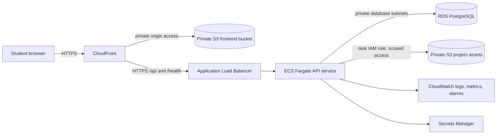

# AWS deployment plan

## Status

This document describes an unprovisioned deployment configuration; it is not evidence of a deployed AWS environment. AWS identity inspection failed with `InvalidClientTokenId`, so existing AWS resources could not be inventoried. No AWS resources have been provisioned, and no live site or external links were changed.

The application now supports registered accounts, password hashing, signed HttpOnly sessions, CSRF checks, profile editing, and server-side ownership checks. Demo personas remain for local development and are disabled by the deployment configuration. Production still requires unique secrets and cloud verification.

## Proposed minimum architecture

CloudFront serves the static React build from a private S3 origin with Origin Access Control and SPA fallback, and proxies API paths to an HTTPS ALB origin so browser cookies remain same-origin. ECS Fargate tasks run in public subnets with no inbound access except from the ALB security group; RDS remains private and accepts connections only from the API security group. The task role grants scoped asset-bucket access; database and session secrets come from Secrets Manager. CloudWatch receives container logs and ECS Container Insights metrics.

The checked-in configuration is in `infra/aws/`: `ecr.yaml` defines a scanned, encrypted ECR repository with bounded image retention; `projectspace.yaml` defines networking, the HTTPS ALB, ECS service, private encrypted PostgreSQL, generated secrets, private frontend and asset buckets, CloudFront OAC/proxy behaviors, IAM roles, health checks, and retained logs. It has not been validated by CloudFormation or exercised in AWS. A valid ACM certificate and API hostname are required; after stack creation, point that hostname to the output `ApiLoadBalancerDns` before relying on CloudFront's API origin. The API hostname must resolve publicly to the ALB for CloudFront to reach it.

The template describes a small always-on test environment, not a production high-availability deployment. It creates billable ECS, ALB, RDS, CloudFront, S3, ECR, Secrets Manager, and CloudWatch resources. Review the template, existing account resources, region availability, cost estimate, and retention settings before deployment.

This is a proposed responsibility split: Fargate supplies managed container compute, RDS supplies a managed relational database, S3 supplies object storage, CloudFront supplies CDN delivery, and CloudWatch supplies monitoring. IAM and security groups enforce identity and network boundaries. These are managed services, but the application remains responsible for its code, database schema, authorization, and data retention.

## Current local configuration

- React static assets are built by `frontend/Dockerfile`; Nginx has SPA fallback in `frontend/nginx.conf`.
- The FastAPI API is containerized by `backend/Dockerfile` and exposes `/health`.
- Docker Compose provides local PostgreSQL, API, and frontend only. It is not an AWS deployment and its sample database password is for local development.
- `DATABASE_URL`, optional split `DATABASE_HOST`/`DATABASE_PORT`/`DATABASE_NAME`/`DATABASE_USER`/`DATABASE_PASSWORD`/`DATABASE_SSLMODE`, `CORS_ORIGINS`, and `VITE_API_BASE_URL` are environment-configured. The cloud task injects database/session secrets at runtime. No AWS credentials are required locally.
- The backend has S3 upload/retrieval endpoints and the form accepts optional images. They return a clear unavailable response until `S3_BUCKET_NAME` is configured. No bucket or task role has been provisioned. Do not put AWS credentials in frontend configuration.

## Resource inventory and cost drivers

The supplied templates create CloudFront, private frontend and asset S3 buckets, ECS cluster/service, an ECR repository, ALB, VPC/subnets/security groups, RDS PostgreSQL and backups, a 30-day CloudWatch log group, and Secrets Manager secrets. An ACM certificate and API hostname are required. CloudWatch alarms and autoscaling policies are not yet configured.

Potential ongoing charges include Fargate vCPU/memory and runtime, ALB hours and capacity units, RDS instance/storage/backup retention, S3 storage and requests, CloudFront requests and egress, ECR storage, CloudWatch ingestion/retention/alarms, Secrets Manager secret storage/API calls, public IPv4 addresses, and network data transfer. NAT gateways can add fixed hourly and processing costs; this template avoids them. API tasks instead receive public IPs in public subnets and their security group accepts inbound application traffic only from the ALB. This is a cost-conscious test topology and should be reviewed before production.

The application defaults to `ap-south-1`. An always-on estimate must include at least one 0.5-vCPU/1-GB API task, one ALB, and one Single-AZ `db.t4g.micro` PostgreSQL instance with 20 GB gp3 storage and seven-day backups; S3/CloudFront depends on traffic, asset size, and requests. ECR storage, CloudWatch ingestion, Secrets Manager, and data transfer also contribute. This is not free. NAT gateways are excluded; tasks receive public IPs in public subnets but accept inbound application traffic only from the ALB. RDS is in unrouted private subnets. This reduces fixed NAT charges but requires a security review.

AWS pricing is usage-, region-, and eligibility-dependent: [Fargate charges for requested CPU/memory and runtime](https://aws.amazon.com/fargate/pricing/), [ALB charges by hours and capacity units](https://aws.amazon.com/elasticloadbalancing/pricing/), [RDS PostgreSQL pricing depends on instance, deployment, storage, backups and transfer](https://aws.amazon.com/rds/postgresql/pricing/), [S3 charges for storage, requests, retrieval and transfer](https://aws.amazon.com/s3/pricing/), and [CloudFront charges for data transfer and requests](https://aws.amazon.com/cloudfront/pricing/). The AWS Pricing Calculator must be run with the selected `ap-south-1` instance sizes, 730 monthly hours for always-on services, storage/backup assumptions, and expected egress before an approval request. This machine's AWS identity check currently fails (`InvalidClientTokenId`), so account-specific free-tier/credit eligibility and a final numeric estimate cannot be confirmed here. No billable resources should be created until that estimate and inventory are reviewed and approved.

## Deployment checklist

1. Restore valid AWS role access and inspect the account/region for existing resources and naming collisions.
2. Review `infra/aws/ecr.yaml` and `infra/aws/projectspace.yaml`, region availability, DNS/certificate inputs, and resource inventory.
3. Run AWS Pricing Calculator for 730 monthly hours, the task/database assumptions, storage/backups, log volume, requests, and egress. Record the estimate before requesting approval.
4. After explicit approval, create ECR, build/scan/push an immutable backend image, and deploy to an isolated test environment.
5. Point the API hostname DNS record at the ALB output and verify the ACM certificate covers that hostname. Wait for CloudFront deployment.
6. Build the frontend with empty `VITE_API_BASE_URL` so it uses same-origin `/api` paths, upload to the private frontend bucket, and invalidate CloudFront.
7. Verify sign-up/login, project CRUD, votes, comments, recommendations, bookmarks, S3 upload/retrieval, HTTPS, CloudWatch logs, health checks, and persistence after restart.
8. Add CloudWatch alarms/scaling, run controlled load and backup-restore checks, and document rollback. These are not yet configured in the templates.
9. Change production traffic only after test verification and separate explicit approval.

## Upload security implementation and remaining verification

The API validates JPEG, PNG, GIF, and WebP signatures, caps images at 5 MiB, generates opaque owner-scoped keys, uses the AWS SDK credential chain, stores with server-side encryption, and issues a 5-minute presigned retrieval redirect. The bucket must block public access and grant only the task role scoped `s3:PutObject`/`s3:GetObject` on `projects/*`. Define lifecycle/cleanup for abandoned uploads and deletion behavior for removed projects. No real bucket upload has been verified yet.
