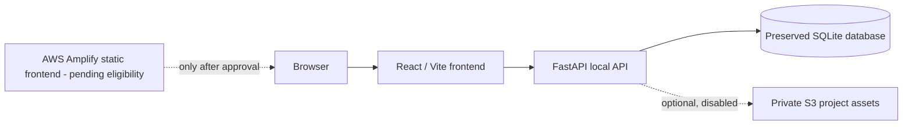

# Strict ₹0 Cloud Demonstration Plan

## Decision

ProjectSpace remains fully functional locally using React, FastAPI, and the preserved SQLite database. This is the only currently verified zero-cost, persistent full-stack configuration. The React frontend may be considered for AWS Amplify Hosting only after the account's plan, credits, free allowance, and overage policy are checked using a working local AWS profile and after explicit approval.

## Why not the existing ECS/RDS template?

The checked-in `infra/aws/projectspace.yaml` is intentionally retained as deployment-ready evidence, but it creates recurring-cost services (ALB, Fargate, RDS, Secrets Manager, public IPv4, and related resources). It is not approved under the ₹0 policy and must not be deployed.

## Architecture and data flow

An Amplify-hosted frontend cannot call a laptop's `localhost` API for public users. Therefore it must not be represented as a fully cloud-hosted application unless a compatible public backend is separately approved.

## Cost controls before any AWS action

1. Verify `aws sts get-caller-identity --profile projectspace --region ap-south-1`.
2. Inspect the account's Billing dashboard, Free Tier usage, credits, expiry, and account-plan state.
3. Create a ₹0 monthly budget/alert and Free Tier usage alerts only after approval.
4. Show service configuration, free allowance, overage rate, deletion path, and residual-charge risk before creating each resource.

## S3 readiness

The backend accepts only validated image uploads and uses private keys under `projects/<student-id>/`. It returns an unavailable response while `S3_BUCKET_NAME` is empty. No AWS credential is stored in source code or frontend configuration. The existing AWS template blocks public bucket access, encrypts objects, and scopes the ECS task role to `projects/*`; it remains unprovisioned.

## Backup and recovery

Keep versioned local checkpoints before migrations. For any future PostgreSQL migration: validate a copied SQLite export, import into a non-production database, count and checksum records, test sign-in/projects/votes/comments, then obtain approval before changing the live configuration. Never overwrite the SQLite source database.

