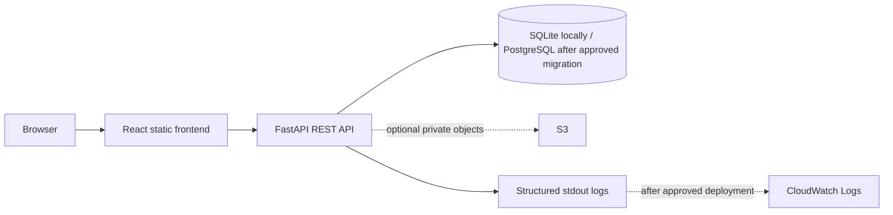

# Cloud Architecture and Data Flow

Local implementation is React + FastAPI + SQLite. Cloud-ready components are Docker, environment configuration, health checks, private S3-capable routes, scoped IAM policy, and CloudWatch-compatible JSON logs. Actually deployed AWS components: none.
